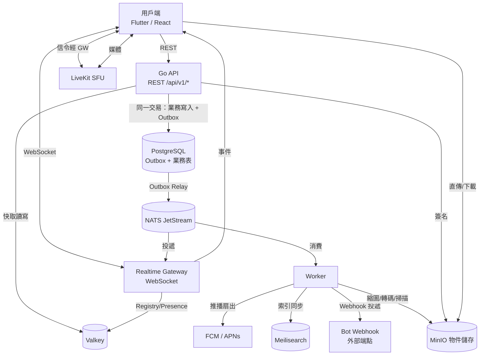
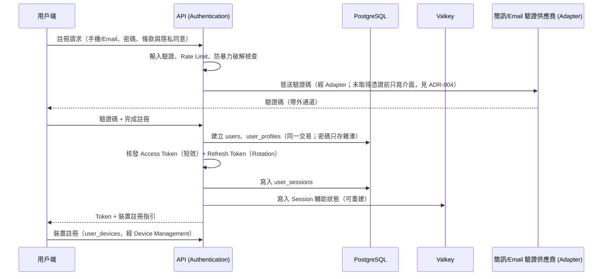
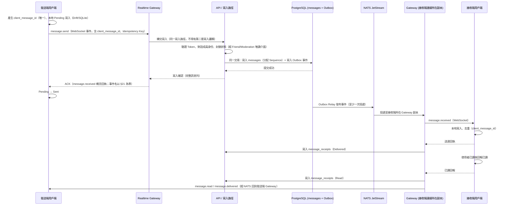
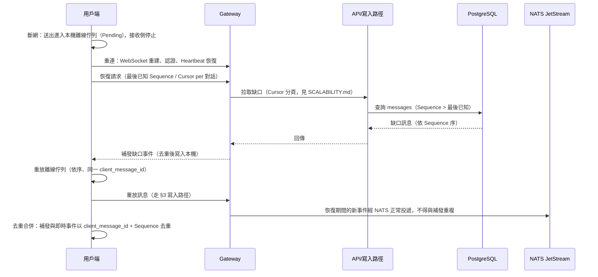
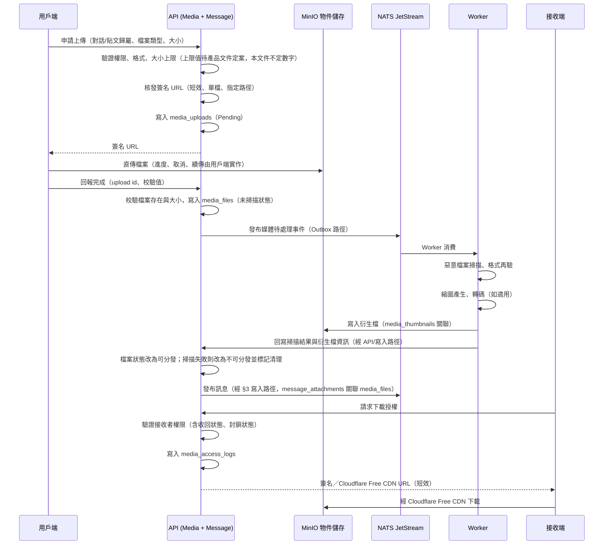
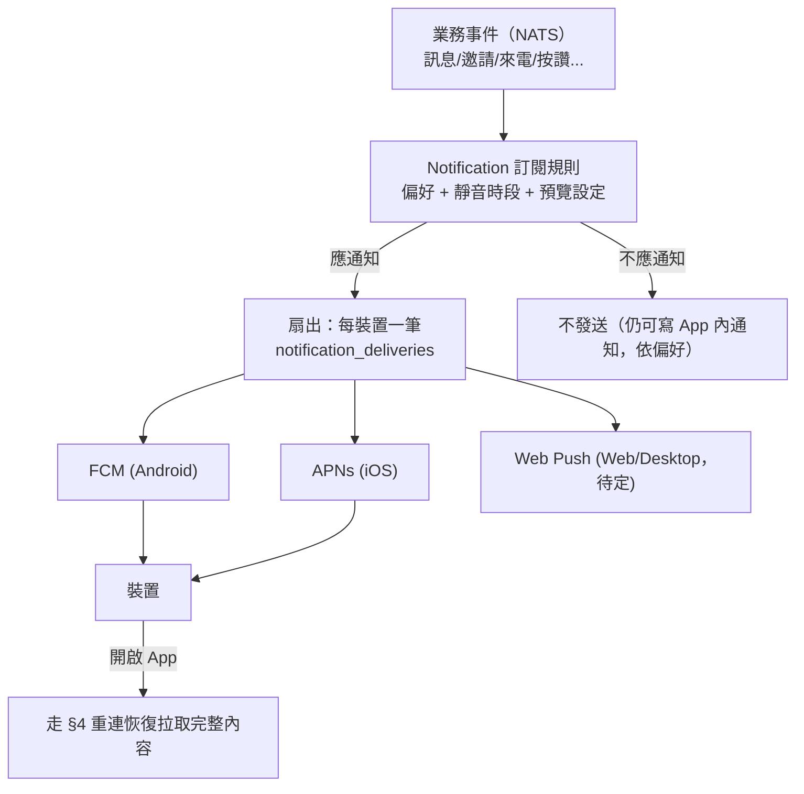
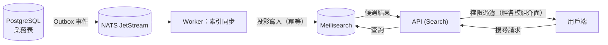
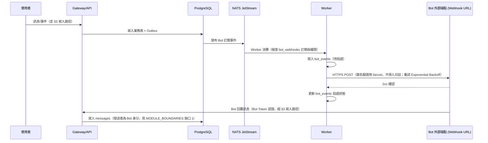

狀態：草案／待批准

# ETHER 資料流（DATA_FLOW.md）

> 依據：`~/workspace/ether/SPEC-SOURCE.md`（模組名／表名／事件名以它為準；§21 API 前綴與 WebSocket 事件名、§22 即時通訊品質機制為準）。
> 本文件只寫資料流，不寫應用程式碼。凡涉及額度、數字、效能指標者，一律不編造；成本一律寫「待查證」。
> E2EE 內容的流向約束見 `SECURITY_ARCHITECTURE.md` §7；本文件各流程中凡稱「訊息內容」，在 E2EE 聊天室皆指密文，伺服器端不得以明文處理。

## 1. 資料流總圖



通用原則（SPEC-SOURCE.md §22）：

- 訊息／事件／狀態資料的可靠性機制：Message ID、Idempotency Key、Sequence Number、ACK、Retry、Exponential Backoff、Message Persistence、Offline Queue、Delivery Receipt、Reconnection Recovery。
- 不得將 WS 連線本身當成可靠送達保證。
- 訊息唯一識別碼、版本控制、冪等，避免重複（SPEC-SOURCE.md §07 跨裝置同步）。

媒體下載經 Cloudflare Free CDN 分發（MinIO 為來源）；接取層為 Cloudflare Free → Traefik → Coraza WAF（見 SYSTEM_ARCHITECTURE.md §3）。

每條流程下文皆標：參與模組、儲存點、一致性保證。儲存點只寫 SPEC-SOURCE.md §20 表名、Valkey、NATS JetStream、MinIO、Meilisearch 五類，不得自創儲存點。

## 2. 註冊登入

### 2.1 流程



登入流程同上，差異：驗證身分（密碼／驗證碼／OAuth／生物辨識的裝置側）→ 檢查帳號狀態與 MFA → 核發新 Token 對（Refresh Rotation，舊 Refresh Token 失效）→ 寫入 `user_sessions` 與登入紀錄 → 異常登入觸發通知事件（經 NATS，Notification 訂閱）。

OAuth（Google／Apple）流程：用戶端取得授權碼 → API 經 Adapter 交換 Token → 驗證身分 → 帳號綁定或建立（首次）→ 其餘同登入。PKCE 與 OIDC 細節見身分與權限模型文件（Phase 00 另冊），本文件不定 OAuth 細節參數。身分服務由 Keycloak 承接（見 ADR-010）：註冊／登入／MFA／Session／Token 的落實經 Keycloak 介面，不得在本流程之外另建一套身分儲存。

### 2.2 儲存點與一致性

| 儲存點 | 內容 | 一致性保證 |
|---|---|---|
| `users`、`user_profiles` | 帳號主檔與公開檔案 | 同一交易建立；註冊未完成驗證前帳號狀態為待驗證（狀態值由 ERD 定案），不得以未驗證帳號發送訊息 |
| `user_sessions` | Session 紀錄 | Refresh Rotation 為原子替換：新 Token 生效與舊 Token 失效在同一交易；重放舊 Refresh Token 須視為可疑並可撤銷全裝置 Session（細節見安全架構） |
| `user_devices` | 裝置紀錄 | 裝置撤銷後，其 Session 須同步失效（事件驅動，見 §4 離線重連恢復的 Session 失效處理） |
| `user_security_keys` | MFA／安全金鑰材料 | 只存驗證用材料，不得存明文密碼或可還原的私鑰 |
| Valkey | Session 輔助狀態、Rate Limit 計數 | 可遺失、可重建；不得作為 Session 的唯一紀錄 |

## 3. 發訊息（Outbox → NATS → Gateway → 投遞 → ACK／回條）

### 3.1 流程



要點：

- **寫入路徑唯一**：無論訊息經 REST 還是 WebSocket 送達，皆走同一寫入路徑（驗證、Sequence 分配、Outbox 寫入）。Gateway 不得自行寫入 `messages`。
- **Sequence**：每對話一個遞增 Sequence（SPEC-SOURCE.md 手冊 G），由寫入路徑在交易內分配，接收端以 Sequence 排序與偵測缺口，不得以客戶端時間排序（排序鐵律概念見 MASTER_SPEC.md §0.3，重用為 ETHER 方向：排序鍵由 ERD／事件協定文件定案）。
- **冪等**：`client_message_id` 在同一對話內唯一（資料庫唯一約束為方向，ERD 定案）；重送命中時回傳已存在的完整訊息列，不建新列。Idempotency Key 與 `client_message_id` 的關係（同一鍵或兩鍵並存）由 ERD／API 標準文件定案，本文件不預設。
- **Outbox**：業務寫入與 Outbox 事件寫入必須在同一 PostgreSQL 交易，提交後才可發布；Outbox Relay 失敗可重試，發布為「至少一次」，消費端必須冪等。
- **ACK 分層**：寫入 ACK（伺服器已持久化）≠ 送達回條（Delivered，接收端裝置已收到）≠ 已讀回條（Read，接收端已讀）。三者狀態值以 SPEC-SOURCE.md §07 的 7 種訊息狀態為準，不得混用。
- **失敗**：寫入失敗 → 發送端標 Failed，可重送（同一 `client_message_id`）；投遞失敗 → NATS 重試（Exponential Backoff）→ 進入死信佇列（DLQ）由 Worker／維運處理，不得無聲丟棄。

### 3.2 儲存點與一致性

| 儲存點 | 內容 | 一致性保證 |
|---|---|---|
| 發送端本機（Drift／SQLite） | Pending 佇列、已確認訊息 | 離線佇列重放仍帶原 `client_message_id`，不得產生重複 |
| `messages` | 訊息列（append-only 方向） | 寫入交易內分配 Sequence；編輯／收回以狀態欄位標記，不得物理刪除 |
| Outbox（PostgreSQL 內，表名待 ERD 定案） | 待發布事件 | 與業務寫入同一交易；發布後標記，不得重複發布同一事件 ID |
| NATS JetStream | 事件／佇列 | 持久化、至少一次投遞、Consumer 冪等去重（事件 ID） |
| `message_receipts` | 送達／已讀回條 | 每（訊息、成員）一筆為方向；重複回報不得覆寫較早時間為較晚時間（概念見 MASTER_SPEC.md NP-03，重用方向） |
| `message_reactions`／`message_replies`／`message_forwards`／`message_pins` | 互動關聯 | 皆參照 `messages`，不得脫離訊息列獨立存在 |

### 3.3 編輯、收回、反應、轉傳

- 編輯：僅傳送者、僅文字類型、僅時限內（時限值由產品文件定案，本文件不定數字）；編輯寫入新內容與編輯標記，保留原值（append-only 方向）；編輯事件經同一 Outbox 路徑發布。
- 收回：僅傳送者、僅時限內；收回後全員檢視改為佔位，附件不得再被下載（Media 存取檢查須認收回狀態）；收回與編輯併發時收回優先（概念見 MASTER_SPEC.md §1(d)，重用方向）。
- 反應／轉傳／置頂／回覆：皆為關聯寫入（`message_reactions` 等），經同一寫入與發布路徑，不得由用戶端直寫事件。

## 4. 離線重連恢復

### 4.1 流程



### 4.2 規則

- 重連恢復以「最後已知 Sequence／Cursor」為準，不得以「全量拉取」為預設恢復方式（全量只在 Cursor 遺失或版本落差過大時走，且須經使用者可見的同步狀態，不得靜默全量）。
- 離線期間的編輯／收回，須待原訊息送達後再依序執行，不得跳過（概念見 MASTER_SPEC.md §1(d) 1.20）。
- 多裝置同步：同一帳號多裝置各有獨立連線與 Cursor；已讀、撤回、設定、草稿同步經同一事件路徑，不得以裝置間直連同步。
- 伺服器重啟：Gateway 重啟後 Registry 由 Valkey／NATS 重建（Valkey 內容可遺失，須可由重連恢復重建）；未投遞事件留在 NATS 佇列，恢復後繼續投遞，不得因重啟丟失已持久化的訊息。
- 快速切網／App 背景／被系統終止：皆走同一重連恢復流程，不得為每種情境另寫恢復邏輯；推播與即時訊息重複時，以 `client_message_id`／事件 ID 去重，不得重複顯示。
- Session 失效（撤銷／遠端登出／Refresh 過期）：重連時認證失敗，用戶端須走重新登入流程，不得以舊 Token 無限重試。

## 5. 媒體上傳（簽名 URL → MinIO → 縮圖 → Cloudflare Free CDN）



儲存點與一致性：

| 儲存點 | 內容 | 一致性保證 |
|---|---|---|
| `media_uploads` | 上傳會話 | Pending 逾時未完成須可清理（清理週期待定，不得編造）；孤兒上傳不得長期佔用儲存 |
| `media_files` | 檔案詮釋資料 | 掃描未完成前不得進入可分發狀態；狀態轉換經 Worker 回寫，不得由用戶端自行標記完成 |
| MinIO | 原檔、縮圖、轉碼檔 | 物件鍵由後端核發，不得由用戶端自定路徑；刪除檔案時須同步清理衍生檔（清理策略待 ERD／維運文件定案） |
| `media_thumbnails` | 縮圖關聯 | 參照 `media_files`，原檔刪除時連帶處理 |
| `media_access_logs` | 存取紀錄 | 每次授權下載寫入一筆，不得以快取繞過紀錄 |
| `message_attachments` | 訊息—檔案關聯 | 附件上傳失敗時訊息不得標為 Sent；訊息寫入失敗時孤兒附件須清理或標記待清理 |

## 6. 通話信令

```mermaid
sequenceDiagram
    participant A1 as 發起端
    participant G as Gateway (WebSocket)
    participant API as API (Call)
    participant P as PostgreSQL
    participant N as NATS JetStream
    participant B1 as 接收端
    participant LK as LiveKit SFU

    A1->>G: call.incoming 意圖（經 Gateway，含對話/群組範圍）
    G->>API: 建立通話紀錄請求
    API->>API: 驗證權限、封鎖狀態、勿擾設定（經相關模組介面）
    API->>P: 寫入 calls（ringing）、call_participants、call_events
    API->>N: 發布來電事件（Outbox 路徑）
    N->>G: 投遞至接收端 Gateway
    G->>B1: call.incoming（WebSocket）
    B1-->>G: 接聽 call.accepted / 拒接 / 逾時未接
    G->>API: 更新 calls 狀態、call_events
    B1->>LK: WebRTC 連線建立（SDP/ICE 經 Gateway 信令轉發，不得經 NATS）
    A1->>LK: WebRTC 連線建立
    LK<-->A1: 媒體
    LK<-->B1: 媒體
    A1->>G: call.ended（掛斷）
    G->>API: 寫入結束狀態、時長、call_events
    API->>P: 更新 calls、call_participants
```

規則：

- 信令（SDP／ICE 交換）走 WebSocket 即時通道，不得走 NATS 佇列（信令須低延遲、點對點，佇列語義不適用）；通話狀態變更（建立／接聽／結束）走 Outbox＋NATS，確保紀錄不丟。
- 來電推播（FCM／APNs）與 WebSocket 來電事件去重：接收端以 `call_id` 去重，不得重複響鈴（見 §7）。
- 逾時未接、忙線、拒接皆須寫入 `call_events` 與通話結果，不得只以 WebSocket 事件帶過。
- 通話媒體不經後端業務服務，不寫入任何儲存點；品質資料（延遲、遺失率）由用戶端上報，寫入方向待 ERD 定案（MASTER_SPEC.md NP-11 品質表概念僅供參考，ETHER §20 無品質表，不得直接沿用）。

## 7. 推播扇出



規則：

- 扇出是「每裝置」而非「每帳號」：`push_tokens` 按裝置登記，撤銷裝置時其 Token 同步失效。
- 推播封包只含通知所需的最小資訊（標題／摘要／關聯 ID）；關閉預覽時不得含訊息內容；E2EE 內容絕對不得進入推播封包（見安全架構）。
- 推播與 WebSocket 投遞重複時，接收端以事件 ID／`client_message_id` 去重，不得重複顯示或重複計未讀。
- 投遞結果（成功／失敗／Token 失效）寫入 `notification_deliveries`；失效 Token 須標記並停止重試，不得無限重發。
- Worker 消費失敗走 NATS 重試與 DLQ，不得阻塞訊息寫入路徑。

## 8. 搜尋索引同步



規則：

- 索引同步是事件驅動的投影，不得由業務寫入路徑同步寫 Meilisearch（業務寫入不得因索引失敗而失敗）。
- 投影寫入必須冪等（事件 ID／文件版本），重放不得產生重複文件；刪除／收回／權限變更亦須同步至索引（文件刪除或可見性更新，不得殘留已無權內容）。
- 搜尋結果的權限過濾在 API 層、回傳前執行，須經各模組的權限介面，不得信任索引內的可見性標記為唯一依據。
- 索引遺失或損毀時，須可由 PostgreSQL 全量重建（重建流程待維運文件定案）；重建期間搜尋可降級，不得謊稱結果完整。
- 搜尋範圍與篩選（關鍵字、日期區間、發送者、媒體／檔案類型）以 SPEC-SOURCE.md §15 為準；排序與分頁規則見 API 標準文件。

## 9. Bot Webhook



規則：

- Webhook 投遞失敗走重試與 DLQ，不得阻塞使用者訊息寫入；重試須帶同一事件 ID，Bot 端須冪等處理。
- Bot 只能收到其訂閱的事件範圍，不得收到未訂閱對話的事件；E2EE 內容不得投遞給 Bot。
- `bot_events` 只存投遞詮釋資料，不得存 E2EE 明文。

## 10. 一致性保證總表

| 保證 | 機制 | 適用流程 |
|---|---|---|
| 寫入原子性 | 業務寫入＋Outbox 同一 PostgreSQL 交易 | 發訊息、通話狀態、Bot 事件、媒體完成回報 |
| 至少一次投遞 | NATS JetStream 持久佇列＋重試 | 全部事件投遞、推播扇出、索引同步、Webhook |
| 冪等 | `client_message_id` 唯一約束、事件 ID 去重、Idempotency Key | 發訊息重送、事件重放、Webhook 重試、索引投影 |
| 順序 | 每對話 Sequence、Cursor 分頁 | 訊息列表、離線恢復、搜尋結果排序方向 |
| 去重 | `client_message_id`、事件 ID、`call_id` | 重送、重連補發、推播與 WS 重複、來電重複 |
| 最終一致 | 事件投影（Meilisearch、通知、分析） | 搜尋索引、推播、Analytics |
| 強一致（單庫交易內） | PostgreSQL 交易 | 帳號建立、Token Rotation、權限狀態變更 |

## 11. 架構缺口（本文件已發現，待審查決定）

1. Outbox 表名與欄位未定（SPEC-SOURCE.md §20 無 Outbox 表），ERD 文件須定案（表名、事件 ID、發布狀態欄位），不得在本文件假裝已有表。
2. `client_message_id` 的資料庫唯一約束範圍（同一對話內）與 Idempotency Key 的關係未定，ERD／API 標準文件須定案。
3. Sequence 的分配方式（每對話序號的並行寫入競爭、序號儲存位置）未定，須在 ERD／寫入路徑設計中定案，不得假設無競爭。
4. 媒體掃描供應商／方式未定（見 ADR-004 阻塞清單中的檔案掃描），掃描失敗的清理週期未定。
5. Web Push（Web／Desktop 推播）的供應商與協定未定；§7 只列位置，不得宣稱已定。
6. 通話品質資料的儲存表未定（ETHER §20 無品質表），見 §6 末段。
7. E2EE 聊天室的訊息寫入路徑與一般聊天室的差異（金鑰材料流向、伺服器可見欄位）須由 E2EE 研究文件定案後回填本文件，不得先行假設兩者同一流程。
8. Keycloak 引入後，Session 撤銷與裝置撤銷的事件時序（Keycloak 事件 vs `user_sessions`／`user_devices` 寫入）待 ADR-010 定案，本文件 §2／§4 只定流程方向。
9. LiveKit CE 自架後，通話信令與媒體面的部署拓撲（公網地址、UDP 埠口、TURN 位置）待 ADR-011 定案；本文件 §6 只定信令／紀錄流程，不定網路拓撲。
