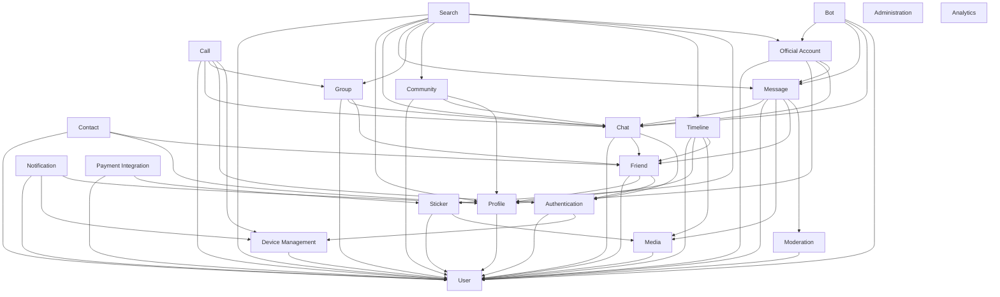

狀態：草案／待批准

# ETHER 模組邊界（MODULE_BOUNDARIES.md）

> 依據：`~/workspace/ether/SPEC-SOURCE.md`（模組名／表名／事件名以它為準，不得改名改義）。
> 本文件只寫邊界，不寫應用程式碼。表名全部取自 SPEC-SOURCE.md §20，64 張表恰好分配一次，無重複、無遺漏（見 §4 對帳）。
> 成本一律寫「待查證」，不得編造額度、數字或效能指標。

### 產品命名對照（僅命名，不改模組邊界）

內部模組識別碼（Chat、Timeline、Call、Official Account、Bot 等）維持不變；對外產品名依品牌架構（見 `docs/brand/BRAND_GUIDELINES.md` §11）：Chat→ETHER Chat、Call（一對一）→ETHER Voice、Call（會議）→ETHER Meet、Group／Community→ETHER Space、Timeline→ETHER Moments、AI 相關→ETHER AI、Official Account／Bot→ETHER Business、創作者工具→ETHER Studio、外部整合→ETHER Connect、內容保存→ETHER Memories。模組邊界、表名、事件名不因產品命名而改。

## 1. 邊界規則（全模組通用）

1. **公開介面唯一通道**：模組之間只經公開介面（Go 介面／套件公開函式、REST 內部呼叫、gRPC）互相呼叫，不得直接讀寫他模組的資料表，不得 import 他模組的內部（`internal/<模組>/...` 非公開）套件，不得共用他模組的內部結構。
2. **依賴方向唯一**：依賴只允許 §2 依賴圖箭頭的方向；反向依賴與循環依賴一律禁止。需要反向通知時，一律走 NATS 事件（事件訂閱不計為直接依賴，見 §3），不得以直接呼叫回頭。
3. **資料表唯一擁有者**：每張表只有一個擁有模組，只有它能寫入該表；他模組如需該資料，一律經擁有模組的讀介面或事件投影，不得直連資料表。讀介面不得回傳他模組不應見的欄位（例如 E2EE 金鑰材料、他人私密欄位）。
4. **商業邏輯歸屬**：重要商業邏輯寫在擁有模組的後端，不得只寫在前端（SPEC-SOURCE.md §27）；前端只做呈現與輸入初步檢查，後端須重驗。
5. **權限裁決在後端**：權限判斷一律在後端（Authentication 提供的授權介面＋各模組的擁有權檢查）；前端的權限判斷只影響顯示，不得作為放行依據；管理員權限不得由前端自行判斷。
6. **事件命名**：跨模組事件名以 SPEC-SOURCE.md §21 WebSocket 事件名為準；內部 NATS 事件主題命名規則待 WebSocket／事件協定文件定案，不得在本文件之外自創事件名。
7. **禁止事項優先於便利**：任何模組的「禁止事項」一節與其他便利做法衝突時，以禁止事項為準；需破例時先提 ADR，不得逕行破例。

## 2. 模組依賴圖

箭頭 `A --> B` 表示「A 直接依賴 B」（A 呼叫 B 的公開介面）。事件訂閱（§3）不畫在此圖。

分層（由底至頂，底層不得依賴頂層）：

- 第 0 層：User。
- 第 1 層：Profile、Device Management、Media。
- 第 2 層：Authentication、Friend、Moderation（Moderation 直接依賴只 User；對其他模組的處分經事件與管理介面，不計直接依賴）。
- 第 3 層：Contact、Chat、Sticker、Timeline。
- 第 4 層：Message、Group、Community。
- 第 5 層：Call、Official Account、Payment Integration。
- 第 6 層：Bot、Notification。
- 第 7 層（只讀／邊緣）：Search、Administration、Analytics。Administration 與 Analytics 無直接業務模組依賴（見各模組小節）；Search 只讀，不得被其他模組依賴。

**無循環依賴**：依賴圖為有向無環圖（DAG）。驗證方式：以 §2 邊集做拓撲排序，須能排出全序；Phase 01 須以靜態檢查（import 關係掃描）把此圖落為 CI 門檻，新增依賴須先更新本文件。拓撲序一例：User → Profile → Device Management → Media → Authentication → Friend → Moderation → Contact → Chat → Sticker → Timeline → Message → Group → Community → Call → Official Account → Payment Integration → Bot → Notification → Search（Administration、Analytics 無直接依賴，可置於任意不破壞方向的位置）。

## 3. 事件訂閱（不計為直接依賴，但須登記）

以下訂閱關係是「發布—訂閱」，訂閱方不得因此反向呼叫發布方的公開介面（除非 §2 已允許該方向）：

| 發布模組（事件來源概念） | 訂閱模組 | 用途 |
|---|---|---|
| Message、Group、Community、Friend、Call、Timeline、Official Account | Notification | 推播扇出素材（通用通知封包，不含呼叫方內部結構） |
| Message、Chat、Group、Community、Timeline、Sticker、Official Account | Search | 搜尋索引同步（見 `DATA_FLOW.md` §8） |
| 全部業務模組 | Analytics | 指標與報表聚合（只讀事件投影，不得回寫業務表） |
| Message、Group、Community、Timeline、User | Moderation | 檢舉素材與風險訊號（處分執行經管理介面） |
| Authentication（登入／登出／撤銷事件） | Device Management | 裝置 Session 狀態同步 |
| Payment Integration（付款完成事件概念） | Sticker | 授權發放觸發（實際發放仍走 Sticker 公開介面，見 Sticker／Payment 小節） |

事件封包只含事件 ID、時間戳記、版本、關聯識別碼與該事件所需的最小欄位（SPEC-SOURCE.md §21 事件通用要求），不得夾帶完整內部列、Token 或明文內容（E2EE 內容絕對不得進入事件）。

## 4. 資料表歸屬對帳（SPEC-SOURCE.md §20，64 張）

| 模組 | 擁有資料表 |
|---|---|
| Authentication | `user_sessions`、`user_security_keys` |
| User | `users`、`user_settings` |
| Profile | `user_profiles` |
| Friend | `friendships`、`friend_requests`、`blocked_users`、`hidden_users` |
| Contact | `contact_sync_records` |
| Chat | `conversations`、`conversation_members`、`conversation_settings` |
| Message | `messages`、`message_receipts`、`message_reactions`、`message_attachments`、`message_replies`、`message_forwards`、`message_pins` |
| Group | `groups`、`group_members`、`group_roles`、`group_invitations`、`group_announcements`、`group_settings` |
| Community | `communities`、`community_members`、`community_channels`、`community_roles`、`community_invitations` |
| Media | `media_files`、`media_uploads`、`media_thumbnails`、`media_access_logs` |
| Sticker | `sticker_packs`、`stickers`、`user_stickers` |
| Call | `calls`、`call_participants`、`call_events` |
| Notification | `notifications`、`notification_preferences`、`push_tokens`、`notification_deliveries` |
| Search | （無自有 PostgreSQL 表；擁有 Meilisearch 搜尋索引投影，見小節） |
| Official Account | `official_accounts`、`official_account_members` |
| Bot | `bot_applications`、`bot_webhooks`、`bot_events` |
| Timeline | `posts`、`post_media`、`post_likes`、`post_comments`、`post_shares`、`post_bookmarks` |
| Payment Integration | `sticker_purchases` |
| Moderation | `reports`、`moderation_actions` |
| Administration | `admin_users`、`admin_roles`、`admin_permissions`、`admin_audit_logs` |
| Analytics | （無自有 PostgreSQL 表；聚合來自事件投影／唯讀來源，見小節） |
| Device Management | `user_devices` |

對帳：2＋2＋1＋4＋1＋3＋7＋6＋5＋4＋3＋3＋4＋0＋2＋3＋6＋1＋2＋4＋0＋1 ＝ 64，與 §20 清單逐張比對無重複、無遺漏。`user_settings` 歸 User（帳號層設定）；通知偏好另有 `notification_preferences` 歸 Notification，兩者不得混用。`sticker_purchases` 歸 Payment Integration（交易紀錄），貼圖授權（`user_stickers`）歸 Sticker，見 Payment 小節的權責切分。

所有表須有 PK、FK、Unique Constraint、必要索引、建立／更新時間、合理刪除策略（SPEC-SOURCE.md §20）；欄位級定義見 ERD 文件，不在本文件重寫。

---

## 5. 各模組責任邊界

### 5.1 Authentication（認證）

- **責任**：註冊／登入驗證、密碼驗證、Email 驗證、手機 OTP 驗證、OAuth（Google／Apple）、MFA、Refresh Token Rotation、Session 管理、登入紀錄、改密／重設、停用／刪除的認證側、異常登入通知的觸發。提供全系統唯一的「身分與授權介面」：驗證 Access Token、解析身分、判斷權限（配合各模組的擁有權檢查）。
- **擁有資料表**：`user_sessions`、`user_security_keys`。
- **對外介面**：註冊、登入、登出、Token 刷新、MFA 驗證、密碼重設、Session 撤銷、Token 驗證（供 API／Gateway）、權限判斷介面。身分服務由 Keycloak 承接（見 ADR-010 與身分文件）：本模組經 Keycloak 介面落實上述能力，不得自寫一套身分儲存與 Keycloak 並存；Keycloak 的 Realm／Client 設定為部署設定，不屬本模組的資料表。
- **依賴（只允許）**：User（身分主檔）、Device Management（裝置信任與登入裝置資訊）。
- **禁止事項**：不得直接讀寫 `users` 以外的使用者業務欄位；不得替他模組判斷業務權限（例如群組管理員身份）；不得儲存明文密碼；不得將 Session 或 Token 寫入日誌；不得繞過 Device Management 自行維護裝置清單。

### 5.2 User（使用者）

- **責任**：使用者主檔（帳號本體）的建立、狀態（正常／停用／刪除流程中的帳號狀態）、帳號層設定（`user_settings`）、資料匯出與帳號刪除流程的帳號側協調。使用者是全系統的身分根，全部模組皆可依賴它，它不依賴任何業務模組。
- **擁有資料表**：`users`、`user_settings`。
- **對外介面**：使用者建立／查詢（內部）、帳號狀態變更、帳號設定讀寫、帳號刪除／匯出協調介面。
- **依賴（只允許）**：無（業務模組依賴為零；僅依賴基礎設施）。
- **禁止事項**：不得依賴 Profile、Friend 或任何上層模組；不得在 `users` 內存放公開檔案、好友關係或裝置資料；不得以 `users` 表兼作管理員表（管理員另有 `admin_users`）。

### 5.3 Profile（個人檔案）

- **責任**：公開檔案（名稱、唯一 ID、頭像、背景、簡介、狀態訊息、QR Code、分享連結）、可見範圍控制、生日的可選公開範圍。檔案的讀取權限（誰可看）由本模組依隱私設定裁決。
- **擁有資料表**：`user_profiles`。
- **對外介面**：檔案讀取（依可見範圍過濾）、檔案更新、公開識別搜尋支援、QR Code 核發／撤銷的檔案側。
- **依賴（只允許）**：User。
- **禁止事項**：不得存放電話、Email 等私密聯絡資料（屬 User／Authentication 側，預設私密）；不得替 Friend 模組判斷好友關係；不得在公開檔案回應中洩漏私密欄位。

### 5.4 Friend（好友）

- **責任**：好友邀請（發送／接受／拒絕／取消／過期／紀錄）、好友關係管理（刪除）、封鎖、隱藏、備註、分類、好友搜尋與排序。封鎖／刪除／隱藏是三種不同狀態，不得混為一談（SPEC-SOURCE.md §06）。
- **擁有資料表**：`friendships`、`friend_requests`、`blocked_users`、`hidden_users`。
- **對外介面**：邀請流程、關係查詢（是否好友／是否封鎖，含方向）、封鎖／解除封鎖、隱藏、備註／分類、好友列表。
- **依賴（只允許）**：User、Profile、Authentication（授權介面）。
- **禁止事項**：不得以 Friend 關係代替 Chat 的成員權限判斷（Chat 須自己驗證成員身份）；不得向被封鎖者揭露封鎖狀態；不得在解除封鎖後補送封鎖期間的訊息；不得把聯絡人同步資料寫入好友表（屬 Contact）。

### 5.5 Contact（聯絡人）

- **責任**：聯絡人同步（須明確授權、限制範圍）、同步紀錄、基於同步結果的推薦輸入（雜湊比對，不得上傳明文號碼，見 MASTER_SPEC.md 功能分析重用部分）。聯絡人同步是「輸入」，好友關係的建立仍走 Friend 邀請流程。
- **擁有資料表**：`contact_sync_records`。
- **對外介面**：同步上傳（雜湊值）、同步紀錄查詢、同步撤回（撤回同意須阻止待傳送資料上傳，概念見 DCL-03 方向，本專案以本模組為準）。
- **依賴（只允許）**：User、Profile、Friend（推薦對象的身分解析）。
- **禁止事項**：不得儲存明文電話號碼；未經授權不得使用通訊錄資料；拒絕通訊錄權限不得阻擋其他功能；不得自動加好友（同步結果只作推薦輸入）。

### 5.6 Chat（聊天室）

- **責任**：對話容器（`conversations`）的建立、成員管理（`conversation_members`）、對話設定（`conversation_settings`：背景、主題、通知、靜音、封存、置頂）。一對一對話的建立須以 Friend 關係為前提（由 Chat 呼叫 Friend 介面驗證，不得自行查好友表）。
- **擁有資料表**：`conversations`、`conversation_members`、`conversation_settings`。
- **對外介面**：對話建立、成員加入／離開、成員查詢、對話設定、對話列表（與 Message 協作，列表的最後訊息預覽經 Message 讀介面）。
- **依賴（只允許）**：User、Friend、Authentication。
- **禁止事項**：不得寫入訊息本體（屬 Message）；不得以對話成員身份代替 Group／Community 的角色權限；不得刪除對話時連帶物理刪除訊息（訊息 append-only 方向，見 `DATA_FLOW.md`）。

### 5.7 Message（訊息）

- **責任**：訊息生命週期：送出、狀態機（Pending、Sending、Sent、Delivered、Read、Failed、Recalled，SPEC-SOURCE.md §07）、編輯、收回、刪除（僅自己檢視）、引用／回覆、轉傳、置頂、表情反應、已讀／送達回條、附件關聯、Sequence 分配、冪等去重（`client_message_id` 概念，見 `DATA_FLOW.md` §3）。訊息是即時鏈路的核心寫入者。
- **擁有資料表**：`messages`、`message_receipts`、`message_reactions`、`message_attachments`、`message_replies`、`message_forwards`、`message_pins`。
- **對外介面**：訊息送出（冪等）、訊息查詢（Cursor 分頁）、編輯／收回／刪除、回覆／轉傳／置頂、反應、回條寫入與查詢、附件關聯寫入。
- **依賴（只允許）**：Chat（容器與成員驗證）、User、Media（附件詮釋資料）、Friend（封鎖檢查）、Moderation（唯讀的處分／封鎖狀態查詢——反向通知走事件，不得反向直連）。
- **禁止事項**：不得直接讀寫 `conversations` 表；不得以 WS 連線存在代替送達保證；不得物理刪除訊息列（append-only）；不得在 E2EE 聊天室將明文寫入伺服器欄位或日誌；不得替 Search 模組建索引（索引同步走事件）。

### 5.8 Group（群組）

- **責任**：群組建立與管理、角色（Owner、Admin、Member）與權限、邀請（連結／QR／審核）、公告、成員管理、@成員、投票（訊息層投票，經 Message）、群組聊天（經 Chat／Message 容器）、離開／解散、所有權轉移、管理紀錄。
- **擁有資料表**：`groups`、`group_members`、`group_roles`、`group_invitations`、`group_announcements`、`group_settings`。
- **對外介面**：群組建立／更新、成員與角色管理、邀請管理、公告管理、群組查詢、權限判斷（本群組內）。
- **依賴（只允許）**：User、Chat、Friend（邀請對象的身分與封鎖檢查）。
- **禁止事項**：不得直接寫入訊息表；不得以群組角色代替對話成員權限（群組聊天室的成員關係仍經 Chat）；不得替 Community 模組做決策（兩者為平級模組，不得互相依賴）。

### 5.9 Community（社群）

- **責任**：社群建立與管理、公開／私密、分類、搜尋、邀請／審核、成員與分級權限、多聊天室（頻道）、子群組、討論區、活動、投票、檢舉入口、黑名單、資料分析入口、操作紀錄。
- **擁有資料表**：`communities`、`community_members`、`community_channels`、`community_roles`、`community_invitations`。
- **對外介面**：社群建立／更新、頻道管理、成員與角色管理、邀請／審核、社群查詢。
- **依賴（只允許）**：User、Chat（頻道對話容器）、Profile（公開資訊）。
- **禁止事項**：不得依賴 Group 模組（頻道不得複用群組表）；不得直接寫入訊息表；不得以社群角色代替全平台管理員權限（屬 Administration）。

### 5.10 Media（媒體）

- **責任**：媒體檔案的詮釋資料、上傳會話、縮圖、存取紀錄、權限驗證的檔案側（檔案能否被某使用者存取，須經呼叫方模組的權限檢查＋本模組的存取紀錄）。實體檔案存於 MinIO 物件儲存，資料表只存詮釋資料與路徑。本模組擁有 MinIO 內的物件命名空間（物件鍵的核發與結構由本模組定，Bucket 劃分與生命週期策略待部署文件定案）；他模組不得自行拼物件鍵或直連 MinIO。
- **擁有資料表**：`media_files`、`media_uploads`、`media_thumbnails`、`media_access_logs`。
- **對外介面**：上傳簽名核發、完成回報、縮圖查詢、存取授權檢查、存取紀錄寫入。
- **依賴（只允許）**：User。
- **禁止事項**：不得判斷訊息／貼文／群組的業務權限（只提供檔案側檢查，業務權限由呼叫方裁決）；不得在未掃描完成前開放檔案分發；不得儲存信用卡等付款資料；不得替呼叫方決定檔案可見範圍。

### 5.11 Sticker（貼圖）

- **責任**：貼圖包、貼圖（靜態／動態／表情／大型）、使用者收藏（`user_stickers`）、最近使用、分類、搜尋、下載、管理、分享、商店展示（免費／付費／限時、推薦、排行榜、創作者頁、購買紀錄的展示側）。購買交易本身屬 Payment Integration。
- **擁有資料表**：`sticker_packs`、`stickers`、`user_stickers`。
- **對外介面**：貼圖包／貼圖查詢、收藏管理、授權發放介面（供 Payment 呼叫）、商店展示查詢。
- **依賴（只允許）**：User、Media（貼圖圖檔）。
- **禁止事項**：不得處理付款（交易紀錄屬 Payment）；不得使用受保護的第三方素材；不得在未授權情況下發放付費貼圖（發放只經授權發放介面）。

### 5.12 Call（通話）

- **責任**：通話會話管理、通話紀錄（`calls`）、參與者（`call_participants`）、通話事件（`call_events`）、信令協調（經 Gateway）、來電／接聽／拒接／忙線／未接狀態、通話品質資料的接收。媒體面屬 LiveKit，本模組只負責會話與紀錄。
- **擁有資料表**：`calls`、`call_participants`、`call_events`。
- **對外介面**：通話建立／接聽／拒接／結束、參與者管理、通話紀錄查詢、品質資料上報介面。
- **依賴（只允許）**：User、Chat（對話容器）、Group（群組通話的成員範圍）、Authentication、Device Management（推播裝置資訊經 Notification 事件，不直連 push_tokens）。
- **禁止事項**：不得儲存或記錄通話內容（音視訊）；不得繞過 Friend 封鎖檢查發起通話（封鎖檢查經 Chat／Friend 介面）；不得替 LiveKit 做媒體轉發決策；不得在信令中夾帶 Token 或金鑰材料。

### 5.13 Notification（通知）

- **責任**：通知的產生、偏好（`notification_preferences`）、推播 Token 管理（`push_tokens`）、投遞紀錄（`notification_deliveries`）、App 內通知、分類、已讀／清除、靜音時段、個別聊天室控制。推播內容須尊重隱私設定，關閉預覽時不得洩漏內容。
- **擁有資料表**：`notifications`、`notification_preferences`、`push_tokens`、`notification_deliveries`。
- **對外介面**：通知建立（通用封包介面，供事件訂閱觸發）、偏好讀寫、Token 註冊／撤銷、投遞狀態查詢。
- **依賴（只允許）**：User、Device Management、Profile（偏好與顯示資訊）。
- **禁止事項**：不得直接依賴 Message、Group、Call 等業務模組（素材一律經事件通用封包）；不得在推播內容中放入 E2EE 明文或關閉預覽時應隱藏的內容；不得替業務模組決定「是否應通知」（業務事件是否成通知，由訂閱規則與偏好決定，不得在業務模組內寫死推播呼叫）。

### 5.14 Search（搜尋）

- **責任**：跨範圍搜尋（好友、使用者 ID、群組、社群、官方帳號、聊天室、訊息、檔案、照片、影片、貼圖、動態貼文）、訊息搜尋（關鍵字、日期區間、發送者、媒體／檔案類型）。結果須遵守存取權限與封鎖規則（搜尋前後皆須過濾，不得先回傳再過濾）。
- **擁有資料表**：無自有 PostgreSQL 表。本模組擁有 Meilisearch 內的搜尋索引投影（索引結構與欄位由本模組定，索引內容是各模組資料的投影，不得作為系統紀錄）；索引的重建來源一律是 PostgreSQL，不得以索引反寫業務表。
- **對外介面**：統一搜尋介面（範圍、關鍵字、篩選、Cursor 分頁）。
- **依賴（只允許）**：User、Profile、Chat、Message、Group、Community、Timeline、Sticker、Official Account（全部為唯讀投影介面）。
- **禁止事項**：不得寫入任何業務表；不得回傳使用者無權存取或被封鎖的內容；不得以搜尋索引代替系統紀錄（索引遺失須可由 PostgreSQL 重建）；不得被其他業務模組依賴。

### 5.15 Official Account（官方帳號）

- **責任**：官方帳號註冊、名稱／頭像／認證標章／介紹、搜尋、加入、封鎖、檢舉入口、客服會話（一對一客服、自動回覆、關鍵字回覆、歡迎／離線訊息、FAQ、圖文訊息、選單、快速回覆、客服分配、標籤、備註）的帳號側。
- **擁有資料表**：`official_accounts`、`official_account_members`。
- **對外介面**：官方帳號建立／更新、認證狀態查詢、加入／封鎖、客服會話介面、成員管理。
- **依賴（只允許）**：User、Profile、Chat、Message（官方訊息經 Message 送出，不得自建訊息表）。
- **禁止事項**：不得自建訊息或通知表；不得以官方帳號身份繞過封鎖或隱私設定；不得替 Bot 模組管理 Token 與 Webhook（屬 Bot）。

### 5.16 Bot（機器人）

- **責任**：Bot 應用建立、Token 核發與撤銷、Webhook 註冊、事件訂閱、收／發訊息的 Bot 側、群組／使用者事件、自動化流程、權限、用量、停用、開發者文件與測試環境的後端側。
- **擁有資料表**：`bot_applications`、`bot_webhooks`、`bot_events`。
- **對外介面**：Bot 申請、Token 管理、Webhook 管理、事件訂閱管理、Bot 訊息收發介面（經 Message）、用量查詢。
- **依賴（只允許）**：Official Account、Message、Chat、User。
- **禁止事項**：不得以 Bot Token 冒充使用者身份；不得繞過訊息權限檢查發訊；不得將 Bot 事件明文（E2EE 內容）寫入 `bot_events`；不得替官方帳號做認證裁決。

### 5.17 Timeline（動態）

- **責任**：動態貼文（文字、單／多圖、影片、GIF、連結、位置、多媒體混合）、按讚、留言、回覆、分享、收藏、隱藏、檢舉入口、隱私（公開／好友／指定好友／僅自己、封鎖排除、留言／互動權限）、編輯、刪除、置頂、排序與推薦的資料側（推薦演算法本身待定，不得編造）。
- **擁有資料表**：`posts`、`post_media`、`post_likes`、`post_comments`、`post_shares`、`post_bookmarks`。
- **對外介面**：貼文建立／編輯／刪除、互動（讚／留言／分享／收藏）、動態列表（依隱私過濾）、隱私設定介面。
- **依賴（只允許）**：User、Profile、Media、Friend（好友可見範圍）。
- **禁止事項**：不得向被封鎖或無權限者展示貼文；不得以 Timeline 兼作聊天室（留言不是訊息，不得寫入 `messages`）；不得替 Moderation 做處分裁決（檢舉只作入口）。

### 5.18 Payment Integration（付款整合）

- **責任**：付款供應商 Adapter（合規第三方，不得自行儲存信用卡完整資訊）、交易紀錄（`sticker_purchases`）、訂單通知的觸發、付款狀態查詢。生活服務的付款／錢包／優惠券／票券入口預留在本模組，不得超前實作未定的商業流程。
- **擁有資料表**：`sticker_purchases`。
- **對外介面**：付款發起（經 Adapter）、付款結果回呼處理、交易紀錄查詢、授權發放觸發（呼叫 Sticker 的授權發放介面）。
- **依賴（只允許）**：User、Sticker。
- **禁止事項**：不得自行儲存信用卡完整資訊；不得直接依賴特定付款供應商 SDK（須經 Adapter）；未取得付款供應商憑證前只寫介面與 Adapter（ADR-004）；不得在付款未確認前發放授權；不得替 Sticker 決定價格或上架（屬 Sticker／Administration）。

### 5.19 Moderation（內容審核）

- **責任**：檢舉受理（`reports`）、審核處分（`moderation_actions`：帳號限制、暫時／永久停權、內容處置）、垃圾訊息偵測與惡意連結警告的規則側、申訴流程入口。處分狀態的唯讀查詢供 Message 等模組在寫入前檢查。
- **擁有資料表**：`reports`、`moderation_actions`。
- **對外介面**：檢舉建立、處分建立／查詢、處分狀態唯讀查詢（供 Message 等模組）、申訴入口。
- **依賴（只允許）**：User（直接依賴僅此；其他模組的素材經事件訂閱，不得直接依賴其模組）。
- **禁止事項**：不得讀取 E2EE 訊息明文（檢舉的 E2EE 內容只能由檢舉者主動提供，伺服器不得自行解密）；不得以審核為由繞過權限讀取私人對話；不得替 Administration 做管理員權限裁決。

### 5.20 Administration（管理）

- **責任**：管理員帳號（`admin_users`）、管理員角色與權限（`admin_roles`、`admin_permissions`）、管理員操作稽核（`admin_audit_logs`）、管理後台的認證與授權。管理操作本身（使用者停權、群組處置、貼圖上下架）經各業務模組的公開介面執行，本模組只負責「誰有權做」與「做了什麼的稽核」，不重寫業務邏輯。
- **擁有資料表**：`admin_users`、`admin_roles`、`admin_permissions`、`admin_audit_logs`。
- **對外介面**：管理員登入（獨立於一般使用者認證）、權限判斷（管理後台專用）、操作稽核寫入／查詢。
- **依賴（只允許）**：無直接業務模組依賴。管理操作由管理後台 API 層呼叫各業務模組公開介面，Administration 模組本身不 import 業務模組。
- **禁止事項**：不得任意讀取 E2EE 訊息（管理員亦不得）；不得與一般使用者共用 Token 或 Session；不得在前端判斷管理員權限；不得刪除或竄改 `admin_audit_logs`。

### 5.21 Analytics（數據分析）

- **責任**：儀表板指標的聚合（總使用者、新增、活躍、DAU／MAU、即時在線、訊息量、群組／社群／官方帳號數、媒體儲存用量、通話用量、系統健康的資料側）、社群資料分析入口。指標定義與口徑待後續文件定案，本文件不定計算公式。
- **擁有資料表**：無自有 PostgreSQL 表。聚合來源為事件投影與唯讀查詢，不得新建未經批准的彙總表冒充系統紀錄；如需物化彙總，須另提 ADR 並列入 ERD。
- **對外介面**：指標查詢介面（供 Admin 儀表板）。
- **依賴（只允許）**：無直接業務模組依賴（事件訂閱＋唯讀來源，見 §3）。
- **禁止事項**：不得寫入業務表；不得以未校準的數字對外宣稱（指標須標註口徑與統計區間）；不得存取 E2EE 明文或個人私密欄位作聚合（聚合須去識別化，方式待安全文件定案）。

### 5.22 Device Management（裝置管理）

- **責任**：登入裝置清單（`user_devices`）、裝置信任、遠端登出（裝置側）、多裝置同步的裝置註冊側、裝置撤銷。裝置是 Session 與推播 Token 的錨點之一。
- **擁有資料表**：`user_devices`。
- **對外介面**：裝置註冊／查詢／撤銷、裝置信任判斷、遠端登出執行。
- **依賴（只允許）**：User。
- **禁止事項**：不得管理 Session 本身（屬 Authentication）；不得替 Notification 管理推播 Token（`push_tokens` 屬 Notification，裝置撤銷時以事件通知 Notification）；不得在裝置紀錄中存放 Token 明文。

## 6. 模組與目錄對照（待 Phase 01 確認）

SPEC-SOURCE.md §26 只列出部分 `services/api/internal/` 目錄（auth、user、friend、chat、message、group、community、media、call、notification、search、moderation），其餘 10 個模組（Profile、Contact、Sticker、Timeline、Official Account、Bot、Payment Integration、Administration、Analytics、Device Management）在 §26 未列目錄名。本文件不擅自補定目錄名：Phase 01 須沿同一命名慣例（`internal/<模組>`）補齊，並以 ADR 或 Phase 01 文件確認，不得出現同一模組兩個目錄或兩個模組共用一個目錄。

## 7. AI Provider Adapter 邊界（跨模組共用能力，非第 23 個模組）

22 個模組之外不新增 AI 模組。AI 能力（Phase 09：對話、摘要、翻譯、RAG、官方 AI 客服）一律經 Provider Adapter 呼叫：

- Adapter 層由後端平台能力提供（Ollama＋vLLM＋LocalAI 優先、外部 AI API 可選擴充，見 ADR-009），商業模組（Message、Timeline、Official Account、Bot 等）只呼叫 Adapter 介面，不得直接依賴任何模型供應商 SDK，不得寫死供應商或模型名。
- 向量檢索（pgvector，已定案，見 ADR-017）由 AI 規範文件定歸屬；Search 模組不得預設擁有向量索引，Analytics 模組不得預設擁有向量資料。
- E2EE 明文不得進入 Adapter（見 `SECURITY_ARCHITECTURE.md` §7）；AI 呼叫的授權、用量、遮罩、保留策略由 Adapter 層統一落實，不得由各模組各自實作。

## 8. 架構缺口（本文件已發現，待審查決定）

1. 官方帳號／Bot 作為訊息發送者時，在 `messages` 內的發送者身分表示方式未定（`sender_id` 參照 `users`，官方帳號／Bot 是否另有身分列，SPEC-SOURCE.md §20 未定欄位，ERD 文件須定案，不得在本文件假裝已定）。
2. 群組／社群投票的表歸屬未定：SPEC-SOURCE.md §20 無獨立投票表，投票須以 `messages`＋關聯表承載或另提新表，ERD 文件須定案（MASTER_SPEC.md NP-04 投票表組屬舊路線提案，僅供參考，不得直接沿用為 ETHER 定案）。
3. 聊天備份（MASTER_SPEC.md NP-06 `chat_backups` 概念）在 ETHER §20 無對應表，備份功能的資料模型未定，屬缺口，不得假裝已有表。
4. `user_settings`（User）與 `notification_preferences`（Notification）、`conversation_settings`（Chat）三者邊界在欄位級仍有重疊風險，ERD 文件須逐欄定歸屬。
5. Moderation 唯讀查詢（Message → Moderation）與事件訂閱（Moderation 訂閱 Message 事件）並存時，兩者的時序語義（檢查當下狀態 vs 事件到達）須在 `DATA_FLOW.md`／ERD 層級定案，不得含糊。
6. Analytics 的物化彙總儲存未定（本文件暫定無自有表），儀表板若需物化彙總須另提 ADR。
7. Keycloak 與 Authentication 模組的 Token／Session／裝置撤銷銜接細節待 ADR-010 與身分文件定案；本文件只定「經 Keycloak 介面落實、不得並存兩套身分儲存」的邊界。
