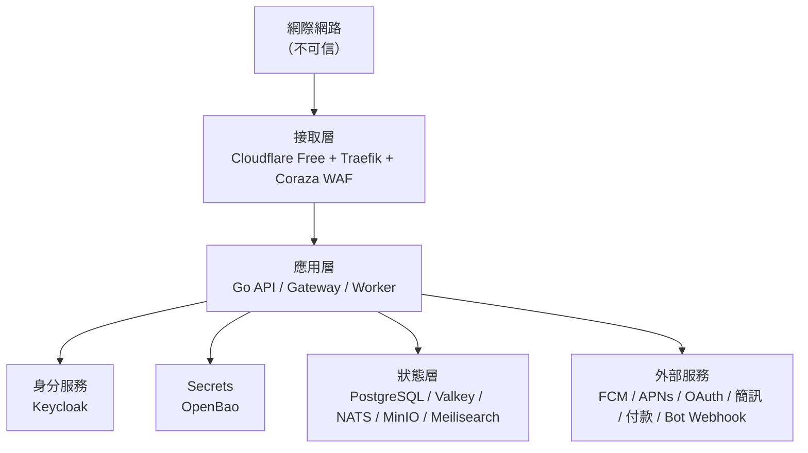

狀態：草案／待批准

# ETHER 安全性架構（SECURITY_ARCHITECTURE.md）

> 依據：`~/workspace/ether/SPEC-SOURCE.md` §17（隱私與安全，核心，事後補充不算）、§05（帳號系統）、§19（管理後台）、§27（執行規則）、頂部「架構調整」一節（2026-11-25 00:33，優先於舊技術棧）。
> 本文件只寫安全性架構，不寫應用程式碼。認證授權的細節概念對照身分與權限模型文件（Phase 00 另冊，本文件不重寫細節）；E2EE 的協定細節見 E2EE 研究文件（另冊）。
> 成本一律寫「待查證」，不得編造額度、數字或效能指標；不得宣稱未經驗證的安全宣稱。

## 1. 安全原則

1. **安全是架構，不是補丁**：SPEC-SOURCE.md §17 為核心要求，事後補充不算。本文件的要求須在 Phase 01 起落實，不得以「後期再補」為由留下無防護的介面。
2. **以後端為準**：所有重要資料操作必須經過後端驗證；重要商業邏輯不得只寫在前端；管理員權限不得由前端自行判斷（SPEC-SOURCE.md §22 模組清單前言與 §27）。
3. **最小權限與縱深防禦**：每一層只擁有完成其職責所需的最小權限；單一防線失效不得等於整體失守（見 §3）。
4. **不信任輸入**：一切來自用戶端、Webhook、Bot、檔案、外部服務的輸入皆為不可信，須驗證、編碼、限流。
5. **誠實宣稱**：資料外洩、加密、刪除等安全宣稱，須以實作與測試證據為準，不得以規格文字代替證據（MASTER_SPEC.md §0.5 概念重用）。E2EE 在實作並驗證前，不得對外宣稱訊息已端對端加密。
6. **免費原則不降安全**：免費／開源替代方案（見 ADR-009）不得以降低安全控制為代價；自架元件的安全更新責任歸維運方，不得假設「開源即安全」。

## 2. 威脅模型

### 2.1 信任邊界

信任邊界：(1) 網際網路 ↔ 接取層；(2) 接取層 ↔ 應用層；(3) 應用層 ↔ 狀態層（內網，不得對外暴露）；(4) 應用層 ↔ 外部服務（皆經 Adapter 與簽名驗證）；(5) 用戶端裝置 ↔ 後端（裝置本身不可信，Token 與金鑰材料須有撤銷機制）。

### 2.2 威脅清單（STRIDE 方向，只列威脅與對策位置，不定風險分數）

| 威脅類別 | 主要威脅 | 對策所在 |
|---|---|---|
| 假冒（Spoofing） | 帳號接管、Token 竊取與重放、Bot 冒充使用者、偽造 Webhook | §4 認證授權、§5 Token、§8 稽核、Webhook 簽名（見 §3.8） |
| 竄改（Tampering） | 訊息／檔案竄改、API 參數竄改、越權改他人資料、Migration 旁路 | §4 授權檢查、§3.6 輸入驗證、E2EE 完整性（§7）、簽名 URL（§3.7） |
| 否認（Repudiation） | 管理員否認操作、使用者否認發送、處分無紀錄 | §8 稽核紀錄（`admin_audit_logs`、`moderation_actions`）、Outbox 事件 |
| 資訊洩漏（Information Disclosure） | E2EE 明文外洩、推播洩漏內容、越權讀取、搜尋洩漏、備份洩漏、日誌洩漏 Secrets | §7 E2EE 邊界、§3.1 傳輸加密、§3.2 靜態加密、§4 權限過濾、§8 日誌去敏 |
| 阻斷服務（Denial of Service） | 暴力破解、訊息洪泛、WS 連線耗盡、媒體上傳耗盡、搜尋重查詢 | §3.4 Rate Limit、§3.5 防暴力破解、Gateway Backpressure（見 `SCALABILITY.md`） |
| 權限提升（Elevation of Privilege） | 前端自判管理員、越權讀取他對話、Bot 越權、SSRF 經媒體／預覽功能 | §4 授權架構、§3.6 輸入驗證、§3.9 檔案掃描、網頁預覽的 SSRF 防護（見 §3.6） |

### 2.3 不在威脅模型內的假設（明列，避免誤判）

- 本文件不假設用戶端裝置未被入侵：裝置遺失／入侵時，以裝置撤銷＋Session 撤銷＋金鑰撤銷為止血手段，不得假設裝置儲存絕對安全。
- 本文件不假設內網絕對安全：狀態層仍須認證、加密與最小權限，不得以「內網」為由關閉驗證。
- 本文件不處理實體安全與主機入侵鑑識細節（屬維運手冊範圍）；但主機入侵時的 Secrets 撤銷與輪替流程須在 §6 定方向。

## 3. 縱深防禦

### 3.1 傳輸加密（TLS）

- 全部對外流量強制 HTTPS／TLS（Web、REST、WebSocket、LiveKit 信令與管理面）；憑證由 Let's Encrypt 核發與自動續期，經 Traefik 管理；不得以 HTTP 提供任何 API 或 WebSocket 端點。
- 內部流量：應用層 ↔ 狀態層、應用層 ↔ Keycloak／OpenBao 亦須加密或置於受控內網且認證，不得以明文在不可信網路傳輸 Token 或 Secrets。
- TLS 版本與密碼套件的最低要求待 Phase 11 安全測試定案（以當期業界基準為準，待查證），本文件不編造版本號；HSTS 與憑證透明度要求由部署文件定案。
- 媒體流量：WebRTC 媒體加密（DTLS-SRTP 方向）；MinIO 存取一律經簽名 URL 與 TLS，不得以公開 Bucket 提供媒體。

### 3.2 靜態加密

- 敏感資料靜態加密：密碼雜湊（以當期業界基準的慢雜湊為方向，演算法與參數待 Phase 03 安全文件定案，不得寫死舊演算法）、Token 雜湊儲存（Refresh Token 不存明文）、E2EE 金鑰材料加密儲存（細節見 E2EE 研究文件）。
- 資料庫與物件儲存的磁碟層加密：自架主機的磁碟加密與備份加密為部署要求（金鑰由 OpenBao 管理，不得與備份同地存放明文金鑰）；備份檔本體加密，備份口令不得存於資料庫。
- 快取（Valkey）不得存放明文密碼、Token 明文、E2EE 明文或完整訊息明文；Session 輔助狀態只存識別與失效資訊。

### 3.3 WAF 與接取層防護（Coraza＋Traefik＋Cloudflare Free）

- Coraza WAF 為應用層前的規則防護（OWASP 規則集方向）：擋常見注入、XSS、協定異常與已知攻擊特徵；規則集版本固定、更新流程與誤擋處理待 Phase 11 定案；WAF 不得作為唯一防線（應用層仍須 §3.6 的驗證與編碼）。
- Traefik 負責路由、TLS 終止、請求大小限制與逾時；Cloudflare Free 提供 DNS、CDN 與邊緣 TLS，不得只靠邊緣防護，來源伺服器不得直接暴露（只接受 Traefik／邊緣來源，來源 IP 限制由部署文件定案）。
- 機器人／濫用流量：Rate Limit 在接取層與應用層兩層落實（見 §3.4），不得只靠其中一層。

### 3.4 Rate Limit（限流）

- 限流維度：依 IP、依帳號、依裝置、依 API 路由、依 WebSocket 連線；登入、註冊、驗證碼發送、密碼重設、訊息發送、搜尋、媒體上傳、Bot 呼叫各有獨立限流（門檻值待查證與壓測，不得編造）。
- 限流狀態存於 Valkey（計數可重建）；限流拒絕須回傳統一錯誤碼，不得以不同回應洩漏帳號存在性（見 §3.5）。
- 限流不得以「擋住正常使用者」為代價上線：誤擋的監控指標（拒絕率）須接入 Grafana 儀表板（見 ADR-012）。

### 3.5 防暴力破解與防帳號接管

- 登入／驗證碼／密碼重設皆限流＋失敗計數；連續失敗達門檻（待定）時延遲回應、要求額外驗證（MFA／驗證碼）或暫時鎖定；鎖定狀態不得以回應差異洩漏帳號存在性。
- Refresh Token Rotation＋重放偵測：舊 Refresh Token 重放視為可疑，須撤銷該帳號全裝置 Session 並觸發安全通知（見 `DATA_FLOW.md` §2）。
- 異常登入通知：新裝置／異常位置登入觸發通知事件（經 NATS，Notification 訂閱）；異常判定的規則待定，不得編造規則。
- 生物辨識只在裝置側解鎖本機金鑰／Session，不得將生物特徵傳至後端。

### 3.6 輸入驗證與注入／XSS／CSRF 防護

- 輸入驗證：全部 API 輸入以 Schema 驗證（型別、長度、值域、格式），伺服器端二次校驗，不得只靠前端；超限請求回傳明確錯誤碼，不得寫入部分資料。
- SQL Injection：資料存取一律參數化查詢／ORM 參數綁定，不得字串拼接 SQL；Migration 與查詢皆經程式碼審查門檻（見 §9）。
- XSS：輸出編碼為預設；富內容（連結預覽、圖文訊息、Bot Rich Message）須經淨化，不得直接插入未淨化的 HTML；Web／Admin 的內容安全政策（CSP）由前端部署文件定案。
- CSRF：Cookie 驗證路徑（若採用）須 SameSite＋Anti-CSRF Token；Token 驗證路徑（Bearer）不得以 Cookie 混用造成 CSRF 面；管理後台的狀態變更操作一律要求有效的管理員 Token＋CSRF 防護（依其實作方式擇一，不得兩者皆無）。
- SSRF：網頁連結預覽、媒體抓取、Webhook 回呼等「後端代抓 URL」功能，須有 Allowlist／內網位址封鎖／逾時與大小限制，不得讓攻擊者經後端探測內網。
- 檔案上傳：格式檢查（魔數＋副檔名雙重檢查）、大小限制、惡意檔案掃描（掃描方案待 ADR-004／部署文件定案，未掃描完成不得分發，見 `DATA_FLOW.md` §5）、可執行檔下載前風險提示（概念見 MASTER_SPEC.md §1(a)，重用方向）。

### 3.7 媒體與簽名 URL 安全

- 媒體上傳／下載一律經 API 核發的短效簽名 URL（單檔、指定路徑、短效期）；物件鍵由後端核發，不得由用戶端自定；MinIO Bucket 不得公開。
- 下載授權檢查：每次授權下載須驗證接收者權限（含收回狀態、封鎖狀態），並寫入 `media_access_logs`；簽名 URL 不得長期有效，不得在日誌或推播中洩漏。
- 縮圖與轉碼檔與原檔同等保護，不得以「縮圖較小」為由降低授權檢查。

### 3.8 Bot 與 Webhook 安全

- Bot Token 與 Webhook Secret 由 OpenBao 核發與輪替，不得入 Git、不得入日誌；Webhook 投遞須帶簽名（HMAC 方向，演算法待 Bot API 文件定案），接收端驗簽失敗拒收。
- Bot 只能存取其訂閱範圍，不得以 Bot Token 冒充使用者、不得繞過訊息權限檢查；Bot 用量與權限由 Bot 模組裁決，見 `MODULE_BOUNDARIES.md`。
- 外部 Webhook 端點的投遞失敗走重試與 DLQ，不得阻塞使用者訊息寫入（見 `DATA_FLOW.md` §9）。

### 3.9 檔案掃描與內容安全

- 檔案掃描為媒體分發的前置門檻（見 §3.6）；掃描供應商／開源方案待查證，未定案前不得宣稱已有掃描。
- 垃圾訊息偵測與惡意連結警告屬 Moderation 模組規則側；連結警告不得以「擋住全部外部連結」為預設，不得誤擋正常連結而不留申訴路徑。
- 兒少保護與內容安全措施的細節屬法規／Moderation 文件範圍，本文件只定「檢舉、處分、申訴、操作紀錄」的架構位置，不得在本文件寫死審查人力或流程。

## 4. 認證授權架構（概念銜接，不重寫細節）

細節（流程、Token 格式、權限模型、資料表欄位）見身分與權限模型文件（Phase 00 另冊，`docs/architecture/IDENTITY_AND_PERMISSIONS.md` 為其一）；本文件只定架構銜接點，兩文件衝突時以身分文件為準（須在審查時對齊）。

- **身分服務**：Keycloak（見 ADR-010）。保留 Email 驗證、登入登出、OAuth（Google／Apple）、MFA、Session、Access／Refresh Token、裝置管理、遠端登出、密碼重設；不得破壞使用者／好友／裝置關聯（`users`、`friendships`、`user_devices` 的關聯語義不變，Keycloak 只承接身分落實，不另建一套使用者主檔）。
- **Authentication 模組**：經 Keycloak 介面落實認證能力，對外提供統一的 Token 驗證與授權判斷介面（供 API／Gateway）；不得自寫一套身分儲存與 Keycloak 並存。
- **授權分層**：(1) 身分驗證（Keycloak／Token）；(2) 粗權限（角色：一般使用者／官方帳號／Bot／管理員，管理員另走 `admin_users` 體系，不得混用）；(3) 細權限（各模組的擁有權檢查：對話成員、群組角色、社群角色、檔案可見範圍、貼文隱私）。三層缺一不可，前端判斷只影響顯示。
- **管理員認證分離**：管理後台獨立認證（`admin_users`），不得與一般使用者 Token 混用；管理員操作一律寫入 `admin_audit_logs`；管理員不得任意讀取 E2EE 訊息（見 §7）。
- **裝置信任**：裝置註冊（`user_devices`）、裝置信任判斷、遠端登出由 Device Management＋Authentication 協作（見 `MODULE_BOUNDARIES.md`）；裝置撤銷須同步失效其 Session 與推播 Token（事件驅動）。
- **Session 與 Token**：短效 Access Token＋Refresh Token Rotation；Refresh Token 不存明文；撤銷（登出／遠端登出／密碼變更／可疑重放）須立即生效，不得只靠 Access Token 自然過期。

## 5. Token、Cookie 與裝置儲存

- Access Token 短效（效期值待身分文件定案，本文件不定數字）；Refresh Token Rotation 為強制；Token 不得入日誌、不得入 URL 查詢參數（除簽名 URL 的短效授權參數外，不得將身分 Token 放 URL）。
- Web 端的 Token 儲存方式（HttpOnly Cookie 或記憶體）由身分文件定案，不得在本文件預設；無論何種方式，皆須有 CSRF 對策（見 §3.6）。
- 行動／桌面端：Token 與金鑰材料存於平台安全儲存（`flutter_secure_storage` 方向），不得存於明文檔案或普通偏好設定；E2EE 金鑰材料的裝置儲存細節見 E2EE 研究文件。

## 6. Secrets 管理（OpenBao）

- **唯一來源**：全部 Secrets（資料庫密碼、Keycloak 憑證、OpenBao 自身根憑證除外、FCM／APNs 憑證、OAuth Client Secret、簡訊／付款供應商金鑰、LiveKit／TURN 憑證、Bot 簽名金鑰、MinIO 金鑰、JWT 簽名金鑰）集中存放於 OpenBao，不得入 Git、不得寫入程式碼、不得寫入 `.env.example`、不得寫入文件範例值。
- **注入方式**：Secrets 經 OpenBao 在部署時注入環境變數或掛載檔案，不得以程式碼讀取 Git 內的設定檔取得；本機開發用 `.env`（不入 Git），其鍵名與格式見 `.env.example`，值一律為佔位。
- **輪替與撤銷**：Secrets 須可輪替（資料庫密碼、Token 簽名金鑰、Webhook Secret 皆須有輪替流程，流程待維運文件定案）；主機入侵或 Secrets 外洩時，須有「撤銷＋輪替＋Session 失效」的應變清單（見 §10 事件應變）。
- **存取控制**：OpenBao 的存取權限按環境與服務最小授權（production 讀取權限限部署身分與指定服務帳號，不得人人可讀）；OpenBao 自身的備份加密與存取稽核為部署要求。
- **禁止事項**：不得將 Secrets 寫入日誌、錯誤追蹤（GlitchTip）、監控標籤、備份檔明文區、聊天訊息或文件；CI 日誌須遮罩 Secrets（GitHub Actions 的 Secrets 遮罩為方向，設定待部署文件定案）。

## 7. E2EE 邊界（伺服器不可讀明文）

細節（協定、X3DH／Double Ratchet、群組加密、金鑰備份與驗證）見 E2EE 研究文件（另冊）；本文件只定伺服器側邊界，邊界被突破即為架構違規：

- **伺服器不可讀明文**：E2EE 聊天室的訊息內容，伺服器不得明文儲存、不得明文讀取、不得寫入日誌、不得進入推播封包、不得投遞給 Bot、不得送往雲端 AI、不得進入搜尋索引（Meilisearch 不得索引 E2EE 明文；E2EE 訊息的搜尋只在本機端，方向待定）。
- **金鑰邊界**：每裝置獨立金鑰、身分金鑰、一次性金鑰、訊息金鑰輪替、前向保密、裝置撤銷、金鑰備份、新裝置驗證、安全金鑰驗證（SPEC-SOURCE.md §17）；伺服器只中繼金鑰交換材料，不得持有可解密的私鑰。
- **協定唯一候選**：Signal Protocol 為 E2EE 唯一候選，不得自研演算法（見 ADR-007）；未經審計前不得宣稱 E2EE 已驗證。
- **功能差異明示**：須明確區分 E2EE 聊天室與一般聊天室的功能差異（例如伺服器側搜尋、AI 處理、Bot、備份的可用性差異），差異清單由 E2EE 研究文件定案，不得以 UI 暗示兩者相同。
- **管理員邊界**：管理員（含 `admin_users`）不得任意讀取 E2EE 訊息；檢舉的 E2EE 內容只能由檢舉者主動提供，伺服器不得自行解密；Moderation 不得以審核為由繞過此邊界。

## 8. 稽核紀錄與日誌安全

- **管理員稽核**：全部管理員操作寫入 `admin_audit_logs`（誰、何時、做什麼、對象、結果），不得刪除或竄改；查詢權限限管理員。
- **商業稽核**：檢舉與處分寫入 `reports`／`moderation_actions`；帳號狀態變更、群組／社群管理操作須留操作紀錄（見 `MODULE_BOUNDARIES.md` Group／Community）。
- **安全事件日誌**：登入／登出、密碼變更、MFA 變更、裝置撤銷、Token 撤銷、權限拒絕、限流拒絕、WAF 攔截，皆須結構化記錄（去識別化方式待定，不得記錄 Token 或密碼）。
- **日誌去敏**：日誌、Trace、錯誤追蹤（GlitchTip）、監控標籤皆不得含 Token、密碼、金鑰、E2EE 明文、訊息明文、完整檔案內容；去敏規則為 CI／部署檢查項（見 §9）。
- **保留**：稽核與安全日誌的保留期限待法規文件定案，不得在本文件編造期限；保留期滿的刪除須可驗證。

## 9. 依賴掃描／SAST／DAST 門檻

- **依賴掃描**：全部依賴（Go、Flutter／Dart、React／TypeScript）皆掃描已知漏洞；高危漏洞在發布前須修復或有書面風險接受（接受權在使用者／統籌，不得由開發者自行接受）；掃描工具待查證（開源方向），不得在 Phase 00 宣稱已選定。
- **SAST**：靜態分析為 CI 門檻（Phase 01 起）：硬編碼 Secrets、SQL 拼接、不安全隨機數、明文 Token 儲存等規則為阻擋項；誤報的豁免須書面記錄，不得靜默豁免。
- **DAST**：動態掃描為 staging／發布前門檻（Phase 11）：認證繞過、越權讀取、注入、XSS、Rate Limit、非法檔案上傳、未授權讀取、帳號接管，皆為 SPEC-SOURCE.md §24 安全測試的必測項；未通過者不得標完成。
- **容器掃描**：全部容器映像掃描漏洞與 Secrets 殘留；基礎映像版本固定，不得用 `latest` 浮動標籤上 production。
- **門檻原則**：門檻只寫「阻擋／不阻擋」與「修復或書面接受」，不編造漏洞數值目標；E2EE 協定審計（ADR-007）獨立於 SAST／DAST，不得以掃描通過代替協定審計。

## 10. 事件應變（方向，細節待維運手冊）

- 應變清單（須在 Phase 11 前成文）：Secrets 外洩（撤銷＋輪替＋Session 失效）、資料庫入侵（隔離＋備份驗證＋通知義務評估）、Token 大規模竊取（全量撤銷＋強制重登）、E2EE 金鑰材料疑似外洩（裝置撤銷＋重新驗證）、DDoS／濫用（接取層限流＋來源封鎖）。
- 通知義務與法規遵循（個資法方向）屬法規文件範圍，本文件不定通知時限與對象。
- 演練：備份還原與撤銷流程須定期演練（頻率待維運文件定案），未演練不得宣稱「可還原／可撤銷」。

## 11. 架構缺口

1. Keycloak 的 Realm／Client／Token 格式細節待 ADR-010 與身分文件定案；本文件只定銜接邊界。
2. 密碼雜湊演算法、TLS 最低版本、Token 效期、限流門檻、鎖定門檻等數值皆未定，待安全／身分文件以當期基準定案，不得編造。
3. 檔案掃描的方案未定（見 ADR-004 阻塞清單）；掃描未定案前，媒體分發的安全門檻為缺口。
4. E2EE 協定細節、群組加密、金鑰備份方式待 E2EE 研究文件與審計（ADR-007）。
5. 告警管道（安全事件通知誰、如何通知）待定（見 MASTER_SPEC.md 未決問題 OQ-12 概念）；GlitchTip 與 Grafana 告警的職責切分待 ADR-012。
6. 備份加密的金鑰管理細節（OpenBao 與備份金鑰的分離存放）待部署／維運文件定案。
