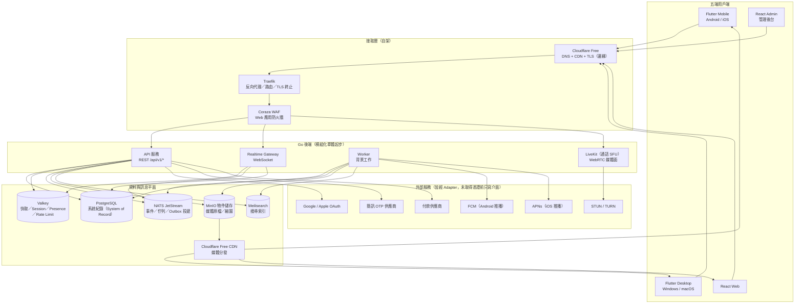
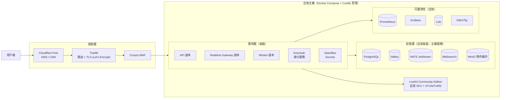

狀態：草案／待批准

# ETHER 系統架構（SYSTEM_ARCHITECTURE.md）

> 依據：`~/workspace/ether/SPEC-SOURCE.md`（使用者 2026-11-25 00:29 下達之 ETHER 完整規格 28 節＋Phase 00–12 執行手冊之摘要，模組名／表名／事件名以它為準）。
> 本文件只寫架構，不寫應用程式碼。本文件所述皆為「設計」，未經實作與驗收前不得宣稱已完成。
> 成本一律寫「待查證」，不得編造額度、數字或效能指標。

## 1. 目標與範圍

ETHER 是全功能跨平台即時通訊生態系統：真正可註冊、登入、加好友、聊天、建群組、傳檔案、語音／視訊通話、收通知、管理社群的完整產品，不是 Demo、不是只有前端畫面。成熟商業級 App 體驗，以上架 Google Play 與 Apple App Store 的產品標準開發。

核心目標（SPEC-SOURCE.md 專案定位，10 項）：Android＋iOS App；可擴充即時通訊後端；可持續運作的即時訊息傳輸架構；使用者／好友／群組／社群系統；多媒體與檔案傳輸；語音／視訊通話；官方帳號與機器人；通知推播；Web 管理後台；安全性／隱私／權限管理。

紅線（SPEC-SOURCE.md §27 執行規則，架構層面重申）：

- 不得用假資料冒充真實功能、不得有無作用按鈕、不得以靜態畫面代替後端。
- 所有功能須有明確資料模型、API、狀態管理、錯誤處理。
- 所有重要資料操作必須經過後端驗證；重要商業邏輯不得只寫在前端；管理員權限不得由前端自行判斷。
- 品牌原創，不得用 LINE 的 Logo、角色、貼圖或受保護素材。

本文件涵蓋：整體架構圖、部署視圖、模組化單體起步與水平擴充路徑、四條鏈路、環境劃分、可觀測性。模組責任邊界見 `MODULE_BOUNDARIES.md`；資料流見 `DATA_FLOW.md`；安全性見 `SECURITY_ARCHITECTURE.md`；擴充見 `SCALABILITY.md`。

## 2. 整體架構圖

說明：

- 用戶端流量先經 Cloudflare Free（DNS＋CDN＋邊緣 TLS），再經 Traefik（反向代理／路由／TLS 終止）與 Coraza WAF 進入後端；憑證由 Let's Encrypt 核發與續期。用戶端永遠只與接取層對話，不直連資料庫、NATS、Meilisearch 或物件儲存（媒體上傳走簽名 URL，見 `DATA_FLOW.md` §5，簽名由 API 核發、權限由 API 驗證）。
- 部署形態為 Docker Compose＋Coolify 自架（見 §3.1 與 ADR-013），全部狀態層皆自架於同一部署架構內，不得假設有受管服務兜底。
- LiveKit Community Edition 自架，是通話媒體面（SFU），信令走 Realtime Gateway（見 `DATA_FLOW.md` §6 與本文件 §9），不得把信令與媒體面混為同一個服務責任。
- 所有外部服務皆經 Adapter 隔離（見 `SECURITY_ARCHITECTURE.md` 與 ADR-004），商業邏輯不得直接依賴特定供應商 SDK；AI 亦同（Provider Adapter，見 §7）。

## 3. 部署視圖

### 3.1 邏輯部署視圖（起步：Docker Compose＋Coolify 自架部署）

部署原則：Docker Compose 為本機與單主機部署的組合單位；Coolify 為容器部署管理平面；OpenTofu 為基礎設施即程式碼工具（主機與網路資源的宣告，見 ADR-013）；GitHub Actions 為 CI／CD。伺服器本身、網域、頻寬等仍可能付費的項目見 §10 與 ADR-009，不得宣稱全系統零成本。

### 3.2 元件與責任

| 元件 | 技術 | 責任 | 不負責 |
|---|---|---|---|
| Flutter Mobile | Flutter＋Dart、Riverpod、GoRouter、Dio、Drift／SQLite、flutter_secure_storage、WebRTC、FCM／APNs | Android／iOS 聊天、好友、群組、社群、通話、貼圖、動態、設定；離線佇列與本機快取 | 商業規則最終裁決（以後端為準）、金鑰明文以外的敏感資料長期儲存 |
| Flutter Desktop | Flutter＋Dart（與 Mobile 共用核心） | Windows／macOS 多欄介面、系統通知、快捷鍵、拖放、托盤（Phase 10，見手冊 L） | 複製手機畫面（各平台須用合理介面） |
| React Web | React＋TypeScript | Web 完整聊天、好友、群組、多媒體、通知、PWA（Phase 10） | 管理員功能（走 Admin） |
| React Admin | React＋TypeScript | 管理後台：儀表板、使用者／群組／社群／貼圖管理、檢舉審核、系統監控；獨立管理員認證與權限 | 讀取 E2EE 訊息明文（明文禁止，見 `SECURITY_ARCHITECTURE.md`） |
| Go API | Go、Echo v5（≥v5.4.7，已定案，見 ADR-016） | 版本化 REST `/api/v1/*`、驗證、授權、驗證輸入、寫入 PostgreSQL、寫 Outbox、簽發媒體上傳簽名 | 即時投遞（走 Gateway＋NATS）、媒體轉碼（走 Worker） |
| Realtime Gateway | Go、WebSocket | 連線 Registry、認證、Heartbeat、重連恢復、多裝置 Session、路由、Rate Limit、Backpressure、Graceful Shutdown | 商業寫入（訊息寫入走 API 或經 Gateway 轉交的同一寫入路徑，不得有兩套寫入邏輯） |
| Worker | Go | 消費 NATS 佇列：推播扇出、搜尋索引同步、媒體縮圖／轉碼、Bot Webhook 投遞、重試與死信處理 | 同步請求回應（不得阻塞 API 請求路徑） |
| PostgreSQL（自架） | PostgreSQL | 全部 64 張 §20 資料表的系統紀錄；Migration 為唯一 Schema 變更途徑 | 搜尋全文索引主力（走 Meilisearch）、快取（走 Valkey） |
| Valkey（自架） | Valkey | 快取、Session／Presence、Rate Limit 計數、Gateway 連線狀態輔助 | 持久紀錄（重啟可遺失的資料才可只放 Valkey） |
| NATS JetStream（自架） | NATS JetStream | 事件匯流排與持久佇列：Outbox 投遞、推播扇出、索引同步、Webhook、離線佇列的伺服器側 | 系統紀錄（消費失敗須可由 PostgreSQL／Outbox 重建） |
| gRPC | gRPC（內部通訊） | 後端內部服務間通訊（模組拆分後的內部介面預留；模組化單體起步階段以行程內呼叫為主，跨行程才走 gRPC，不得為 gRPC 而 gRPC） | 對外 API（對外一律 REST＋WebSocket） |
| MinIO 物件儲存（自架） | MinIO 物件儲存 | 媒體原檔、縮圖、備份檔本體（加密後） | 權限裁決（存取一律經 API 簽名與驗證） |
| Meilisearch（自架） | Meilisearch | 訊息／好友／群組／社群／官方帳號／動態／檔案的搜尋索引 | 權限裁決（結果須再經權限過濾，見 `DATA_FLOW.md` §8） |
| LiveKit Community Edition（自架） | LiveKit CE＋WebRTC、STUN／TURN、SFU | 多人通話媒體轉發、房間與參與者管理、通話品質監測資料來源；細節見 §9 | 信令、通話紀錄寫入（走 Gateway／API） |
| Traefik | Traefik | 反向代理、路由、TLS 終止、Let's Encrypt 憑證自動化 | WAF 規則（屬 Coraza）、商業邏輯 |
| Coraza WAF | Coraza WAF | Web 應用防火牆規則（OWASP 規則集方向，規則版本與調校待 Phase 11 定案） | 身分驗證（屬 Keycloak／Authentication）、商業授權 |
| Cloudflare Free | Cloudflare Free | DNS、CDN 媒體分發、邊緣 TLS | 來源伺服器邏輯、WAF 唯一防線（不得只靠邊緣） |
| Keycloak | Keycloak | 身分服務：Email 驗證、登入登出、OAuth（Google／Apple）、MFA、Session、Access／Refresh Token、裝置管理、遠端登出、密碼重設的概念銜接（細節見 ADR-010 與身分文件）；Authentication 模組經 Keycloak 介面落實，不得自寫一套身分儲存與之並存 | 好友／群組等業務權限（屬各業務模組） |
| OpenBao | OpenBao | Secrets 集中管理與注入（見 `SECURITY_ARCHITECTURE.md`） | 任何 Secrets 入 Git 或入程式碼 |
| Prometheus＋Grafana＋Loki＋GlitchTip | Prometheus／Grafana／Loki／OpenTelemetry／GlitchTip | 指標、儀表板、日誌聚合、錯誤追蹤（自架）；覆蓋 API、WebSocket、資料庫、Worker、Media、AI（見 §8 與 ADR-012） | 商業稽核（屬 `admin_audit_logs`／`moderation_actions`） |
| Docker Compose＋Coolify＋OpenTofu＋GitHub Actions | Docker Compose、Coolify、OpenTofu、GitHub Actions | 本機／單主機組合、部署管理、基礎設施宣告、CI／CD（見 ADR-013） | 應用程式邏輯 |

### 3.3 五端對照

五平台為 Android、iOS、Windows、macOS、Web（SPEC-SOURCE.md 技術棧／手冊 A）。功能矩陣本身屬 Phase 00 其他文件（PRD／平台矩陣），不在本文件重寫；本文件只定架構約束：

- 五端共用同一後端 API 與 WebSocket 事件協定（事件名以 SPEC-SOURCE.md §21 為準），不得為某平台另開一套協定。
- Mobile／Desktop 共用 Flutter 核心（狀態管理、資料層、領域邏輯），平台差異只在表現層與平台通道（通知、CallKit、托盤、快捷鍵）。
- Web／Admin 共用 React＋TypeScript，但為兩個獨立應用：Web 是使用者產品，Admin 是管理員產品，認證與權限完全分離，不得共用 Session。
- 無障礙、深淺色、多語系、動態字體、高 DPI、低網速與離線支援，是五端的共同架構需求，不是某一端的附加功能。

## 4. 模組化單體起步與水平擴充路徑

決定見 ADR-001。本節只寫路徑，不重寫決策理由。

### 4.1 起步形態：模組化單體

- 一個 Go Monorepo 服務程式碼庫（目錄規範見 SPEC-SOURCE.md §26：`services/api` 下 `cmd/`、`internal/<模組>`、`migrations/`、`api/`、`tests/`），22 個模組各有獨立的 `internal/<模組>` 套件邊界，只經公開介面互相呼叫（見 `MODULE_BOUNDARIES.md`）。
- 部署時 API、Realtime Gateway、Worker 是三個行程角色，但由同一程式碼庫建置；行程間通訊走 NATS 與 gRPC（內部），不得經資料庫輪詢互相傳遞事件。
- 資料庫起步為單一 PostgreSQL（邏輯上按模組分表，物理上同庫），Valkey、NATS、Meilisearch、MinIO 各一組，不得在起步階段就按模組拆庫。

### 4.2 擴充路徑（觸發條件待查證，不得預設數字門檻）

擴充只在觀測到瓶頸證據（延遲、佇列積壓、連線數、CPU／記憶體、儲存）後進行，順序如下，不得跳級拆分：

1. **無狀態水平擴充**：API 與 Gateway 副本數增加（Traefik 分流；Gateway 須經 Valkey／NATS 做跨副本路由，不得假設同一連線永遠落在同一副本）。
2. **Worker 水平擴充**：按 NATS Consumer Group 增加 Worker 副本；冪等消費是前提（見 `DATA_FLOW.md`）。
3. **資料層擴充（自架叢集）**：PostgreSQL 唯讀複本（讀寫分離，寫入只走主庫）、Valkey 叢集化、NATS 叢集化、Meilisearch 節點增加、MinIO 多節點＋Cloudflare Free CDN 分發；叢集化皆為自架，不得預設受管服務。
4. **模組拆分**：僅當某一模組的擴充需求、部署節奏或故障隔離需求與其他模組明顯不同，且其公開介面已穩定時，才將該模組拆為獨立服務；拆分後內部呼叫改走 gRPC，事件改走 NATS，資料表歸屬不變，不得在拆分時順手改表名或事件名。
5. **多區域部署**：最後一步。須先解決跨區資料一致性、Sequence 分配、E2EE 金鑰同步、媒體複製與法規遵循，細節待查證，不得在 Phase 00 宣稱多區域架構已定案。

### 4.3 不可做的事

- 不得以「未來會拆微服務」為由，在起步階段就讓模組互相直連資料表、共用內部結構或跳過介面。
- 不得以「單體比較簡單」為由，把全部邏輯寫進單一巨大檔案或單一模組（SPEC-SOURCE.md §27 第 7 條）。
- 拆分不得改變對外 API 前綴（`/api/v1/*`）與 WebSocket 事件名。

## 5. 四條鏈路

### 5.1 請求鏈路（REST，同步）

用戶端 → Cloudflare Free → Traefik（TLS）→ Coraza WAF → API → 驗證（Authentication 模組：Access Token、權限）→ 輸入驗證 → 商業邏輯（所屬模組）→ PostgreSQL 交易（商業寫入＋Outbox 寫入同一交易）→ 回應。

- 讀取可經 Valkey 快取（見 `SCALABILITY.md`），快取未命中回源 PostgreSQL；寫入一律先寫 PostgreSQL，快取失效走「寫入後失效／更新」，不得先寫快取再寫資料庫。
- 所有 API 回應須含統一錯誤碼（細節見 API 標準文件，不在本文件重寫）；逾時、重試與冪等鍵規範見 `DATA_FLOW.md`。
- 管理後台請求走同一 API 服務的不同路由前綴（`/api/v1/admin`，見 SPEC-SOURCE.md §21 前綴清單），但認證主體是 `admin_users`，不得與一般使用者 Token 混用。

### 5.2 即時鏈路（WebSocket＋NATS，半同步）

用戶端 → Cloudflare Free → Traefik（WebSocket 升級、TLS）→ Coraza WAF → Realtime Gateway（認證、Registry、Heartbeat）→ 訊息寫入路徑（見 `DATA_FLOW.md` §3：Outbox → NATS → Gateway 投遞 → ACK／回條）。

- Gateway 本身不持久化訊息本體；持久化只在 PostgreSQL（Outbox／messages）與 NATS JetStream（佇列）。
- 伺服器重啟、快速切網、App 背景／被系統終止時，恢復一律走重連恢復流程（見 `DATA_FLOW.md` §4），不得將 WS 連線本身當成可靠送達保證（SPEC-SOURCE.md §22）。
- 事件名、事件 ID、時間戳記、版本、關聯識別碼為強制欄位（SPEC-SOURCE.md §21）；事件協定細節見 WebSocket 協定文件。

### 5.3 媒體鏈路（非同步為主）

用戶端 → API（申請上傳：驗證權限、格式、大小）→ 簽名 URL → MinIO 物件儲存（直傳）→ 用戶端回報完成 → API 寫入 `media_uploads`／`message_attachments` → NATS 事件 → Worker（掃描、縮圖、轉碼）→ MinIO（衍生檔）→ Cloudflare Free CDN 分發 → 接收端經簽名／授權 URL 下載。

- 檔案須經權限驗證、格式檢查、惡意檔案掃描後才可被他人存取（SPEC-SOURCE.md §07）；掃描未完成前，檔案不得進入可分發狀態。
- 媒體鏈路的完整時序、儲存點與一致性保證見 `DATA_FLOW.md` §5。

### 5.4 通話鏈路（信令＋媒體分離）

信令：用戶端 → Gateway（WebSocket，事件 `call.incoming`／`call.accepted`／`call.ended` 等，見 SPEC-SOURCE.md §21）→ 對端用戶端；通話紀錄寫入經 API（`calls`、`call_participants`、`call_events`）。

媒體：用戶端 ↔ LiveKit（SFU）↔ 對端用戶端，WebRTC 加密媒體，經 STUN／TURN 穿透。

- 來電推播（FCM／APNs、CallKit）走推播扇出（見 `DATA_FLOW.md` §7），與 WebSocket 投遞去重，不得重複響鈴。
- 通話內容（音視訊）不得寫入 PostgreSQL、MinIO 或任何紀錄表；只記錄通話紀錄詮釋資料（對象、時間、時長、結果）。
- 通話信令的完整流程見 `DATA_FLOW.md` §6；平台差異（Android 背景來電、iOS CallKit、Windows／macOS 原生通知、Web 權限）由各端實作，後端信令不分平台。

## 6. 環境劃分

依 SPEC-SOURCE.md 手冊 C：區分 local／development／staging／production 四個環境。

| 環境 | 用途 | 資料 | Secrets | 部署方式 |
|---|---|---|---|---|
| local | 開發者本機開發與測試 | 本機 Docker Compose 內的拋棄式資料，禁止接真實外部服務 | `.env` 本機檔案，不入 Git；範例只放 `.env.example`（無真值） | Docker Compose（本機 VM 無 docker，見 ADR-008，local 驗證皆為「待 CI 或有 Docker 的環境驗證」，不得寫已驗證） |
| development | 團隊共用開發驗證 | 測試資料，可重置；不得含真實使用者資料 | OpenBao 或環境變數注入，不入 Git | Docker Compose＋Coolify，成本待查證 |
| staging | 發布前驗收（與 production 同形） | 類生產結構的測試資料；外部服務用測試模式／沙箱 | OpenBao，不入 Git | 與 production 相同的部署流程（OpenTofu＋GitHub Actions＋Coolify），成本待查證 |
| production | 正式服務 | 真實使用者資料；備份與還原演練為必要條件 | OpenBao，不入 Git；Production Secrets 絕對不入 Git | OpenTofu＋GitHub Actions＋Coolify，成本待查證（阻塞項，見 ADR-009；仍可能付費項目見 §10） |

規則：

- 四個環境的設定差異只以環境變數與 Secrets 注入表達，不得以程式碼分支（`if env == "prod"` 散落各處）承載環境差異；環境名稱本身須為可列舉的固定集合。
- 任何環境皆不得將敏感金鑰寫入原始碼（SPEC-SOURCE.md §27 第 11 條）；`.env.example` 只寫鍵名與格式說明。
- local 與 development 不得共用 production 的資料庫、物件儲存 Bucket 或推播憑證。
- 升級路徑：local → development → staging → production，staging 驗收未通過不得部署 production；回滾流程見部署手冊（Phase 11，待撰寫），Phase 00 不預寫回滾細節。

## 7. AI 整合位置（架構預留，不在本階段實作）

依 SPEC-SOURCE.md 手冊 K（Phase 09 ETHER AI）與架構調整（2026-11-25 00:33）：AI 採 Ollama＋vLLM＋LocalAI 優先、外部 AI API Adapter 可選擴充；供應商不得寫死；須可切換模型、Streaming、Tool Calling、上下文、Token 統計、資源管理。AI 功能（對話、訊息摘要／翻譯、知識庫 RAG、官方 AI 客服）經 Provider Adapter 接入，商業邏輯不得直接依賴特定供應商 SDK。

架構約束（只定位置與邊界，細節見 AI 資料處理規範文件，Phase 00 另冊）：

- AI 呼叫一律經後端 Adapter，不得由用戶端直連模型供應商或本機模型服務（金鑰、用量與遮罩都在後端）。
- 本機模型（Ollama／vLLM／LocalAI）與外部 AI API 共用同一 Adapter 介面，切換模型不得改商業邏輯；向量檢索走 pgvector（已定案，見 ADR-017），RAG 索引的權限隔離與刪除同步為強制要求。
- 資源評估為阻塞項：須評估 CPU／RAM／GPU／VRAM，不得假設一般伺服器跑得動所有模型；模型清單、量化方式與硬體需求待查證，未評估前不得宣稱某模型可在目標主機上線。
- E2EE 聊天室的明文不得自動送往雲端 AI（手冊 K 明文規定）；一般聊天室的 AI 處理亦須經授權、用量與保留策略，細節待 AI 規範文件定案。
- AI 呼叫須有 Rate Limit、Token Budget、敏感遮罩、Prompt Injection 防護、使用紀錄與保留策略；未取得外部模型供應商金鑰前，外部路徑只寫介面與 Adapter（ADR-004 同款原則），本機路徑亦須待有 Docker 的環境驗證。

## 8. 可觀測性

### 8.1 Logging

- 結構化日誌（JSON 為方向，格式由 Phase 01 定案），每筆含：時間戳記、服務／行程角色、請求／事件 ID、使用者識別（去識別化方式待安全文件定案）、模組名、結果。
- 日誌分級：ERROR／WARN／INFO／DEBUG；production 預設不輸出 DEBUG，不得在日誌中輸出 Token、密碼、金鑰、E2EE 明文、訊息明文（E2EE 聊天室）或完整檔案內容。
- 管理後台須可查詢錯誤日誌（SPEC-SOURCE.md §19 系統管理），查詢權限限管理員。

### 8.2 OpenTelemetry＋Prometheus＋Grafana＋Loki＋GlitchTip（自架）

- API、Gateway、Worker、LiveKit CE、Media 處理、AI Adapter 皆接入 OpenTelemetry：Trace（請求／事件跨服務追蹤）、Metrics（延遲、吞吐、錯誤率、佇列深度、連線數）、Logs 關聯（以 Trace ID 串連）。覆蓋範圍見 ADR-012。
- 指標由 Prometheus 抓取、Grafana 呈現；日誌由 Loki 聚合；錯誤追蹤由 GlitchTip 自架承接（應用錯誤與例外，不得含 Token、密碼、金鑰或 E2EE 明文）。
- Trace 取樣率、保留期限、儲存容量皆待查證（自架主機磁碟與保留策略），不得在 Phase 00 宣稱已選定；保留策略須與法規保留要求對齊（見安全架構）。
- 關鍵指標（只列維度，不定門檻數值）：API 延遲分位數、WS 連線數與重連率、訊息投遞延遲與重試率、NATS 佇列積壓與死信數、Worker 處理延遲、媒體上傳成功率、通話建立成功率與 TURN 中繼率、推播送達回報率、資料庫連線池使用率與慢查詢、AI 呼叫延遲與 Token 統計。

### 8.3 Health Check

- 每個行程角色皆提供 Health Check 端點：存活（liveness）與就緒（readiness）分離；就緒檢查須含其依賴的狀態層連通性（PostgreSQL／Valkey／NATS），但不得因單一非關鍵依賴（如 Meilisearch）未就緒就全體拒絕流量——降級策略由 Phase 01 定案。
- 容器 Health Check 為部署必要條件（手冊 C）；Traefik 只導流至就緒副本。
- 告警（Alerting）規則與管道為待定項（見 MASTER_SPEC.md 未決問題 OQ-12 告警管道，概念重用），Phase 00 不定告警管道與門檻數值。

### 8.4 稽核與追蹤

- 管理員操作一律寫入 `admin_audit_logs`（見 `MODULE_BOUNDARIES.md` Administration 模組）；商業稽核（檢舉、處分、帳號狀態變更）寫入 `moderation_actions` 與 `reports`。
- 分散式追蹤 ID 須貫穿 REST → Outbox → NATS → Gateway → Worker 全鏈路，否則跨服務的問題無法定位。

## 9. LiveKit Community Edition 自架專節（通話媒體面）

決策見 ADR-011。本節為 SYSTEM_ARCHITECTURE.md 內的專節；擴充面的 TURN／頻寬評估亦見 `SCALABILITY.md` §8（交叉引用，兩處不得矛盾）。

### 9.1 保留功能（不得刪、不得降級）

- 一對一語音／視訊通話、多人語音／視訊通話、螢幕分享、房間（Room）與參與者管理、主持人／參與者控制、靜音與鏡頭管理。
- WebRTC＋SFU：LiveKit CE 自架 SFU，媒體經 SFU 轉發；STUN／TURN 穿透；信令仍走 Realtime Gateway（見 §5.4 與 `DATA_FLOW.md` §6），不得把信令併入 LiveKit。
- 通話品質監控：品質資料（延遲、遺失率、抖動、解析度變化）由用戶端上報，經 API／Worker 寫入監控管線（Prometheus 指標＋Loki 日誌），品質摘要的呈現規則待產品文件定案；通話品質監測的儲存位置（指標為主、不得寫入業務表）見 ADR-012。
- 平台來電體驗不變：Android 背景來電、iOS CallKit、Windows／macOS 原生通知、Web 權限處理，皆由各端實作，LiveKit CE 的更換不得改變信令事件名（SPEC-SOURCE.md §21）。

### 9.2 自架部署需求

- LiveKit CE 以容器部署於同一 Docker Compose＋Coolify 架構內（或同一主機群的獨立容器組，部署拓撲由部署文件定案）；須有公網可達的地址與埠口（UDP／TCP 範圍待 LiveKit CE 官方文件查證，本文件不編造埠號），Traefik 只處理信令與管理面的 HTTP，媒體 UDP 流量不得經 Traefik 轉發（須直達 LiveKit／TURN）。
- STUN／TURN 須自架或選用開源 TURN 服務（部署形態待查證）；TURN 憑證（臨時帳密）由後端核發、短效，不得寫死，不得入 Git。
- LiveKit CE 的版本固定、設定檔版本控管（無 Secrets）、Health Check 與日誌接入 Loki，皆為部署必要條件；Docker Compose 啟動與通話皆為「待 CI 或有 Docker 的環境驗證」，本機 VM 無 docker，不得寫已驗證。

### 9.3 TURN 頻寬與公網部署評估（特別評估項）

- TURN 中繼流量是「仍可能付費項目」（見 §10）：當雙方皆在對稱 NAT 後或 UDP 被擋時，媒體須經 TURN 中繼，頻寬消耗隨通話人數、時長與解析度上升；免費原則不代表 TURN 頻寬免費，實際費用取決於主機頻寬方案與用量，成本待查證，不得宣稱零成本。
- 評估必須做的事（Phase 07 前完成，不得跳過）：(1) 以官方文件確認 TURN 部署的公網 IP、埠口與頻寬需求；(2) 在有公網的測試環境實測一對一與多人通話的 TURN 中繼率與頻寬；(3) 訂出 TURN 中繼率的監控指標與告警（見 ADR-012）；(4) 若頻寬成本超過使用者免費原則可接受範圍，須停下由使用者決定（是否限流、降解析度策略或另覓方案），不得靜默上線後超額。
- 降級原則：TURN 不可用時，通話建立須明確失敗並提示，不得假裝連線正常；弱網時優先保障語音（概念見 MASTER_SPEC.md §2(d)，重用方向）。

## 10. 架構缺口（Phase 00 已知，待後續文件或審查決定）

1. Gin 或 Echo 二選一已定案為 Echo v5（見 ADR-016）；本缺口項關閉。
2. 自架主機的規格、位置與成本未定（伺服器為仍可能付費項目，成本待查證，見 ADR-009）；本文件不預設任何主機方案。
3. STUN／TURN 的自架方案與部署拓撲未定（見 ADR-011）；通話品質監測的儲存位置已定方向（監控管線），細節待 ADR-012。
4. gRPC 的實際使用範圍未定：起步階段行程內呼叫為主，跨行程介面清單待 Phase 01 依拆分需要列出。
5. 多區域部署的資料一致性方案未定，不得在 Phase 00 宣稱已解決。
6. OpenTelemetry 後端保留策略、告警管道未定（自架 Prometheus＋Grafana＋Loki 已定方向，見 ADR-012）。
7. AI Adapter 的介面清單、向量庫（pgvector，已定案，見 ADR-017）、模型資源評估皆未定，屬 AI 規範文件範圍。
8. Keycloak 與現有 Authentication 模組的介面銜接細節（Token 格式、Session 同步、裝置撤銷）待 ADR-010 與身分文件定案。
9. 仍可能付費項目清單：網域、伺服器、簡訊 OTP、Apple Developer、Google Play 上架、外部 AI API、TURN 頻寬等（見 ADR-009）；正式部署成本待查證且為阻塞項，不得新增付款方式（使用者免費原則）。

## 11. 參考

- `MODULE_BOUNDARIES.md`（模組依賴與邊界）
- `DATA_FLOW.md`（資料流與一致性）
- `SECURITY_ARCHITECTURE.md`（安全性架構）
- `SCALABILITY.md`（擴充架構，§8 LiveKit CE 擴充評估）
- `../decisions/ADR-001-模組化單體起步.md`、`ADR-002`（已取代，見其內文加註）、`ADR-006-WebSocket與NATS即時架構.md`、`ADR-009-免費開源替代總決策.md`、`ADR-010-Keycloak身分架構.md`、`ADR-011-LiveKit-CE自架與TURN評估.md`、`ADR-012-可觀測性自架.md`、`ADR-013-Docker-Compose與Coolify部署.md`
- SPEC-SOURCE.md §21（API 前綴與 WebSocket 事件名）、§26（目錄規範）、頂部「架構調整」一節（2026-11-25 00:33，優先於舊技術棧）
