狀態：草案／待批准

# ETHER 資料庫 ERD

## 1. 依據與效力

- 本文件以 `~/workspace/ether/SPEC-SOURCE.md` §20 為最高準據。表名一律與 §20 逐字一致，不得增刪改名。
- 功能深度補充參考 `~/workspace/messenger-app/MASTER_SPEC.md`；舊合約 `~/workspace/messenger-app/CONTRACTS.md` 僅供參考。舊路線（Kotlin＋Supabase）的表名、欄位名、事件名與 ETHER §20 不同者，一律以 §20 為準，差異寫入 ADR（見 §10 缺口）。
- 本文件只定資料庫結構草案，不寫應用程式碼，不宣稱任何功能已完成、已驗證。
- 不得編造額度、數字、效能指標。凡涉及容量、併發量、延遲、保留天數者，一律寫「待查證／待決定」，不得以推測數字作為承諾。
- 架構調整（2026-11-25 00:33 使用者指令，優先於舊技術棧）：搜尋投影改 Meilisearch、物件儲存改 MinIO、快取改 Valkey、向量承載為 pgvector（已定案，見 ADR-017）。本文件表名與結構不變（§20 為準），僅修搜尋／向量／儲存／快取相關敘述；舊付費服務名不得殘留。

## 2. 表數核對警示（重要缺口）

任務交辦稱 §20 有 60 張表；逐字清點 SPEC-SOURCE.md §20 所列，實際為 **64 張表**。

本文件列出全部 64 張，一張不刪。如審查認為其中有表應合併或刪除，須由使用者／統籌決定並修訂 SPEC-SOURCE.md 後，本文件再跟隨修訂；本文件不得自行刪表以湊 60 張。

清單（依 §20 分組順序，編號為本文件編號，非 §20 原文編號）：

| 分組 | 表名 |
|---|---|
| 使用者（6） | `users`、`user_profiles`、`user_settings`、`user_devices`、`user_sessions`、`user_security_keys` |
| 好友（5） | `friendships`、`friend_requests`、`blocked_users`、`hidden_users`、`contact_sync_records` |
| 聊天室（10） | `conversations`、`conversation_members`、`conversation_settings`、`messages`、`message_receipts`、`message_reactions`、`message_attachments`、`message_replies`、`message_forwards`、`message_pins` |
| 群組（6） | `groups`、`group_members`、`group_roles`、`group_invitations`、`group_announcements`、`group_settings` |
| 社群（5） | `communities`、`community_members`、`community_channels`、`community_roles`、`community_invitations` |
| 媒體（4） | `media_files`、`media_uploads`、`media_thumbnails`、`media_access_logs` |
| 貼圖（4） | `sticker_packs`、`stickers`、`user_stickers`、`sticker_purchases` |
| 動態（6） | `posts`、`post_media`、`post_likes`、`post_comments`、`post_shares`、`post_bookmarks` |
| 通話（3） | `calls`、`call_participants`、`call_events` |
| 通知（4） | `notifications`、`notification_preferences`、`push_tokens`、`notification_deliveries` |
| 官方帳號與 Bot（5） | `official_accounts`、`official_account_members`、`bot_applications`、`bot_webhooks`、`bot_events` |
| 管理（6） | `admin_users`、`admin_roles`、`admin_permissions`、`admin_audit_logs`、`reports`、`moderation_actions` |

## 3. 草案欄位聲明

- §20 只定表名，未定欄位名。以下逐表所列欄位名均為**草案欄位、待 Migration 定稿**；Migration 撰寫時須逐欄覆核，定稿後以 Migration 為準，本文件再同步修訂。
- 欄位型別亦為草案推導（以 PostgreSQL 為準）：識別碼以 `uuid` 為草案預設；時間以 `timestamptz` 為草案預設；金額（如有）不得用浮點型別，型別與單位待定稿。舊規格（MASTER_SPEC.md）中的欄位定義僅作推導參考，不得直接視為 ETHER 定稿。
- 每張表皆須有主鍵（PK）。外鍵（FK）、唯一約束（Unique）、索引以下逐表列出，皆為草案，待 Migration 定稿。
- `created_at`／`updated_at`：每張表逐項說明。原則草案：可變動的實體表兩欄皆有；僅追加（append-only）的紀錄／日誌／關聯快照表僅 `created_at`，無 `updated_at`，以 `created_at` 為準；關聯表若其狀態可變動，則加 `updated_at`。定稿時不得為 append-only 表補寫 `updated_at` 來掩蓋修改軌跡；狀態變更須以新列或狀態欄位＋時間欄位記錄，另見 §9。
- 刪除策略：每張表逐項說明，策略名詞定義見 §8。最終保留期限、匿名化方式待保留政策決定（對照舊規格未決問題 OQ-03 的同類問題，ETHER 的保留天數尚未決定，一律寫「待決定」，不得預填天數）。

## 4. 命名與通用慣例（草案）

- 表名：`snake_case` 複數或集合名，以 §20 為準，不得改名。
- 欄位名：`snake_case`；主鍵一律名為 `id`（草案；複合主鍵的關聯表除外，見逐表說明）；外鍵欄位名為 `<被參照表單數>_<id>` 形式，例如 `user_id`、`conversation_id`（草案）。
- 狀態／類型欄位：以 `text` 加檢查約束（`CHECK`）列舉值域為草案方向，值域清單待各模組定稿；不得以自由文字寫入未列舉的狀態。枚舉值域的完整清單不在本文件預寫，須由各階段文件定稿。
- 布林欄位預設值、空值許可以下逐表以「草案」標示，定稿時覆核。
- 不得將密碼明文、Token 明文、Bot 金鑰明文、私鑰寫入任何資料表。雜湊值、加密後的憑證參照方式待安全性架構文件定稿；本文件只在相關表註明「不得存明文」，不預寫雜湊演算法。
- 不得將信用卡完整資訊寫入任何資料表（SPEC-SOURCE.md §16）。付款相關表（如 `sticker_purchases`）只存交易參照與狀態，金額、支付方式等欄位形態待合規決定，見逐表備註。

## 5. 關係圖（領域層級總覽）

以下 mermaid 圖為領域層級總覽，非逐欄 ERD；逐表 FK 以 §6 為準（草案欄位、待 Migration 定稿）。

```mermaid
erDiagram
    users ||--o{ user_profiles : "擁有"
    users ||--o{ user_settings : "擁有"
    users ||--o{ user_devices : "擁有"
    users ||--o{ user_sessions : "擁有"
    users ||--o{ user_security_keys : "擁有"
    users ||--o{ friendships : "發起或接受"
    users ||--o{ friend_requests : "發起或接收"
    users ||--o{ blocked_users : "封鎖"
    users ||--o{ hidden_users : "隱藏"
    users ||--o{ contact_sync_records : "同步"
    users ||--o{ conversation_members : "加入"
    conversations ||--o{ conversation_members : "包含"
    conversations ||--o{ conversation_settings : "設定"
    conversations ||--o{ messages : "包含"
    messages ||--o{ message_receipts : "回條"
    messages ||--o{ message_reactions : "反應"
    messages ||--o{ message_attachments : "附件"
    messages ||--o{ message_replies : "引用"
    messages ||--o{ message_forwards : "轉傳"
    messages ||--o{ message_pins : "置頂"
    groups ||--o{ group_members : "包含"
    groups ||--o{ group_roles : "定義角色"
    groups ||--o{ group_invitations : "邀請"
    groups ||--o{ group_announcements : "公告"
    groups ||--o{ group_settings : "設定"
    communities ||--o{ community_members : "包含"
    communities ||--o{ community_channels : "包含頻道"
    communities ||--o{ community_roles : "定義角色"
    communities ||--o{ community_invitations : "邀請"
    media_files ||--o{ media_thumbnails : "縮圖"
    media_files ||--o{ media_uploads : "上傳紀錄"
    media_files ||--o{ media_access_logs : "存取紀錄"
    sticker_packs ||--o{ stickers : "包含"
    users ||--o{ user_stickers : "擁有"
    sticker_packs ||--o{ sticker_purchases : "購買紀錄"
    posts ||--o{ post_media : "媒體"
    posts ||--o{ post_likes : "按讚"
    posts ||--o{ post_comments : "留言"
    posts ||--o{ post_shares : "分享"
    posts ||--o{ post_bookmarks : "收藏"
    calls ||--o{ call_participants : "參與者"
    calls ||--o{ call_events : "事件"
    users ||--o{ notifications : "接收"
    users ||--o{ notification_preferences : "偏好"
    users ||--o{ push_tokens : "裝置權杖"
    notifications ||--o{ notification_deliveries : "投遞紀錄"
    official_accounts ||--o{ official_account_members : "成員"
    official_accounts ||--o{ bot_applications : "Bot 申請"
    bot_applications ||--o{ bot_webhooks : "Webhook"
    bot_applications ||--o{ bot_events : "事件"
    admin_users ||--o{ admin_audit_logs : "操作紀錄"
    admin_roles ||--o{ admin_permissions : "權限"
    reports ||--o{ moderation_actions : "處置"
```

文字關係說明：

- 使用者為全系統主體：`users` 為帳號根實體；`user_profiles`、`user_settings`、`user_devices`、`user_sessions`、`user_security_keys` 皆以 `user_id` 參照 `users`。
- 好友關係的三種狀態（好友／邀請／封鎖／隱藏）分表建模，不得混為一談：`friendships` 存已成立或歷史關係狀態；`friend_requests` 存邀請流程；`blocked_users`、`hidden_users` 各自獨立。關係方向、自我關係禁止、雙向合併規則待好友模組定稿（對照舊規格 §3 邊界條件，僅供參考）。
- 聊天室：`conversations` 為容器；`conversation_members` 為成員關聯；`messages` 屬於一個 `conversations`；訊息的回條、反應、附件、引用、轉傳、置頂分表參照 `messages`。`groups` 與 `communities` 為群組／社群的管理實體，與 `conversations` 的對應方式（群組／社群是否各對應一個或多個 `conversations`，`community_channels` 是否對應 `conversations`）尚未定稿，見 §10 缺口；本文件不預寫對應欄位為已定，逐表備註中標明待定稿。
- 媒體：`media_files` 為檔案實體；`media_uploads` 為上傳過程紀錄；`media_thumbnails` 為衍生縮圖；`media_access_logs` 為存取稽核。`message_attachments` 與 `post_media` 參照 `media_files` 的方式待媒體模組定稿（直接參照或經由儲存路徑），見 §10 缺口。
- 動態、通話、通知、官方帳號／Bot、管理：各領域內部關係見逐表 FK；跨領域關係（例如 `reports` 指向使用者／訊息／群組／社群／動態等不同目標）以多型參照（目標類型＋目標識別碼）為草案方向，目標類型值域待定稿，不得以單一 FK 假裝涵蓋全部目標類型。

## 6. 逐表定義

以下每張表皆含：用途、主要欄位（草案欄位、待 Migration 定稿）、PK、FK、Unique、索引、created_at／updated_at、刪除策略。

欄位表中的「草案」標示適用整節；不再逐欄重複標示。

### 6.1 使用者

#### 6.1.1 `users`

- 用途：帳號根實體。註冊、登入、停用、刪除的帳號主體；不存放公開檔案顯示資料（顯示資料在 `user_profiles`）。
- 主要欄位：`id`、`phone_number`（可為空，是否存明文、是否雜湊待安全性架構定稿；不得在本文件假設）、`email`（可為空）、`password_hash`（可為空，OAuth 帳號可能無密碼；不得存明文）、`status`（帳號狀態，值域待定稿，例如啟用／停用／待刪除）、`registered_at`、`last_login_at`（可為空）。
- PK：`id`。
- FK：無。
- Unique：`phone_number`（若非空）、`email`（若非空）各別唯一，唯一性範圍與空值處理待定稿；不得以本文件假設電話／Email 必填。
- 索引：`phone_number`、`email` 唯一索引（同上）；`status` 索引（草案）。
- created_at／updated_at：皆有。`created_at` 為註冊時間；`updated_at` 為帳號資料變更時間。
- 刪除策略：軟刪除／停用優先。帳號刪除申請須經冷靜期與流程（流程待定稿）；不得直接物理刪除 `users` 列而不處理關聯資料。刪除後的關聯資料處理（訊息、動態、群組成員資格）按各表刪除策略與保留政策辦理，須在 Migration／保留政策文件中逐項定稿。

#### 6.1.2 `user_profiles`

- 用途：使用者公開檔案與顯示資料（名稱、唯一 ID、頭像、背景、簡介、狀態訊息、生日可見範圍等，見 SPEC-SOURCE.md §05）。
- 主要欄位：`id`、`user_id`、`display_name`、`public_id`（公開識別碼／顯示 ID，草案名）、`avatar_media_id`（可為空，參照媒體，參照方式待定稿）、`bio`（可為空）、`status_message`（可為空）、`birthday`（可為空）、`birthday_visibility`（值域待定稿）、`qr_code_token`（可為空，可撤銷，草案）、`profile_visibility`（值域待定稿）。
- PK：`id`。
- FK：`user_id` → `users.id`。
- Unique：`user_id` 唯一（一使用者一檔案，草案）；`public_id` 唯一（若非空）。
- 索引：`user_id` 唯一索引；`public_id` 唯一索引；`display_name` 搜尋索引（草案，搜尋實作待定稿）。
- created_at／updated_at：皆有。
- 刪除策略：隨 `users` 處理。帳號刪除時，公開檔案的處理（刪除或匿名化）待保留政策定稿；不得在使用者僅修改檔案時物理刪除歷史版本（歷史版本是否保留待定稿）。

#### 6.1.3 `user_settings`

- 用途：使用者個人設定（外觀、語言、聊天偏好等，見 SPEC-SOURCE.md §18）。與通知偏好分表（`notification_preferences`），不得混為一談。
- 主要欄位：`id`、`user_id`、`language`、`theme`（值域待定稿）、`font_size`（值域待定稿）、`chat_background`（可為空）、`media_auto_download`（值域待定稿）、`other_settings`（草案，結構化設定欄位，形態待定稿；不得以無結構欄位掩蓋未定稿的設定項，定稿時須逐項列出）。
- PK：`id`。
- FK：`user_id` → `users.id`。
- Unique：`user_id` 唯一（草案）。
- 索引：`user_id` 唯一索引。
- created_at／updated_at：皆有。
- 刪除策略：隨 `users` 刪除（CASCADE 草案）。設定無獨立保留價值，帳號刪除時一併刪除，待定稿確認。

#### 6.1.4 `user_devices`

- 用途：登入裝置清單與裝置信任管理（裝置名稱、平台、最後活動、撤銷狀態，見 SPEC-SOURCE.md §05、§17）。
- 主要欄位：`id`、`user_id`、`device_name`、`platform`（值域待定稿）、`device_identifier_hash`（草案，僅存雜湊或去識別化識別碼，不得存可直接識別裝置的原始識別碼明文，方式待安全性架構定稿）、`last_active_at`（可為空）、`is_trusted`、`is_revoked`、`revoked_at`（可為空）。
- PK：`id`。
- FK：`user_id` → `users.id`。
- Unique：無全域唯一約束草案；同一使用者同一裝置識別碼的唯一性待定稿。
- 索引：`(user_id, last_active_at)`；`(user_id, is_revoked)`（草案）。
- created_at／updated_at：皆有。`updated_at` 記錄信任／撤銷狀態變更時間。
- 刪除策略：裝置撤銷為狀態標記，不得物理刪除撤銷紀錄（稽核需要）。帳號刪除時，裝置紀錄的處理待保留政策定稿；撤銷紀錄本身在保留期內不得刪除。

#### 6.1.5 `user_sessions`

- 用途：登入 Session 管理（Session 參照、裝置關聯、到期、撤銷，配合 Refresh Token Rotation，見 SPEC-SOURCE.md §05）。
- 主要欄位：`id`、`user_id`、`device_id`（可為空，→ `user_devices.id`）、`session_token_hash`（草案，僅存雜湊，不得存 Token 明文）、`refresh_token_hash`（草案，僅存雜湊，不得存 Token 明文）、`expires_at`、`last_active_at`（可為空）、`is_revoked`、`revoked_at`（可為空）、`revoked_reason`（可為空，值域待定稿）。
- PK：`id`。
- FK：`user_id` → `users.id`；`device_id` → `user_devices.id`（可為空）。
- Unique：`session_token_hash` 唯一（草案）；`refresh_token_hash` 唯一（草案）。
- 索引：`(user_id, expires_at)`；`(user_id, is_revoked)`（草案）。
- created_at／updated_at：皆有。`updated_at` 記錄撤銷／活動更新時間。
- 刪除策略：到期或撤銷的 Session 不得立即物理刪除，須保留至保留期屆滿以供稽核（保留期待決定）；保留期屆滿後可硬刪除。遠端登出為撤銷標記，不得假裝本機資料已清除。

#### 6.1.6 `user_security_keys`

- 用途：使用者安全金鑰參照（身分金鑰、一次性金鑰等 E2EE 相關公開金鑰參照，見 SPEC-SOURCE.md §17）。私鑰一律只存於裝置本機，不得上傳、不得寫入本表。
- 主要欄位：`id`、`user_id`、`device_id`（可為空，→ `user_devices.id`）、`key_type`（值域待 E2EE 文件定稿）、`key_id`（草案，裝置端金鑰編號）、`public_key`（公開金鑰 material，形態待 E2EE 文件定稿）、`signature`（可為空，簽章，形態待定稿）、`is_used`（一次性金鑰用）、`used_at`（可為空）、`expires_at`（可為空）。
- PK：`id`。
- FK：`user_id` → `users.id`；`device_id` → `user_devices.id`（可為空）。
- Unique：`(user_id, device_id, key_type, key_id)`（草案）。
- 索引：`(user_id, key_type)`；`(user_id, is_used)`（草案）。
- created_at／updated_at：僅 `created_at`。金鑰參照為 append-only 方向；狀態變更（用畢、撤銷）以 `is_used`／`used_at` 或新列記錄，不得以 UPDATE 抹除歷史。是否需要 `updated_at` 待 E2EE 文件定稿；本文件不預寫。
- 刪除策略：不得物理刪除使用過的金鑰參照（前向保密稽核需要）。裝置撤銷時，相關金鑰參照標記失效（失效欄位／狀態待定稿），不得刪除。保留期限待 E2EE 文件與保留政策定稿。
- 備註：本表是否拆分為身分金鑰／一次性金鑰／簽章預金鑰等多張表，待 E2EE 研究與風險文件定稿；§20 只定一張表名，本文件不得擅自增表。

### 6.2 好友

#### 6.2.1 `friendships`

- 用途：已成立的好友關係（雙向接受後成立）。封鎖、隱藏、邀請各有專表，不得混入本表。
- 主要欄位：`id`、`user_id`、`friend_id`（關係對端）、`status`（值域待定稿；草案方向：已成立／已解除的歷史狀態）、`established_at`（可為空）、`ended_at`（可為空）。
- PK：`id`。
- FK：`user_id` → `users.id`；`friend_id` → `users.id`。
- Unique：`(user_id, friend_id)` 唯一（草案；有序配對或無序配對的儲存方式待定稿，不得以本文件假設雙向存兩列或一列，定稿時須明定並以約束保證）。
- 索引：`(user_id, status)`；`(friend_id, status)`（草案）。
- created_at／updated_at：皆有。
- 刪除策略：好友解除為狀態標記（`ended_at`／狀態），不得物理刪除關係歷史（稽核與「封鎖期間訊息不補送」等語義需要歷史）。帳號刪除時的關係列處理待保留政策定稿。

#### 6.2.2 `friend_requests`

- 用途：好友邀請流程（發送／接受／拒絕／取消／過期／紀錄，見 SPEC-SOURCE.md §06）。
- 主要欄位：`id`、`requester_id`、`addressee_id`、`status`（值域待定稿，例如待處理／已接受／已拒絕／已取消／已過期）、`message`（可為空，邀請附言）、`expires_at`（可為空）、`responded_at`（可為空）。
- PK：`id`。
- FK：`requester_id` → `users.id`；`addressee_id` → `users.id`。
- Unique：待處理邀請的唯一性待定稿（草案方向：同一方向同一對象同時僅一筆待處理邀請；雙向同時邀請的合併規則待定稿，不得預寫）。
- 索引：`(addressee_id, status)`；`(requester_id, status)`；`expires_at`（草案）。
- created_at／updated_at：皆有。`updated_at` 記錄狀態變更時間。
- 刪除策略：邀請紀錄不得物理刪除（流程稽核需要）；過期／取消皆為狀態標記。保留期限待決定。

#### 6.2.3 `blocked_users`

- 用途：封鎖關係（單向）。封鎖與刪除、隱藏是不同狀態，不得混為一談。
- 主要欄位：`id`、`user_id`（封鎖者）、`blocked_user_id`（被封鎖者）、`reason`（可為空，值域待定稿）、`blocked_at`、`unblocked_at`（可為空）。
- PK：`id`。
- FK：`user_id` → `users.id`；`blocked_user_id` → `users.id`。
- Unique：`(user_id, blocked_user_id)` 在「封鎖中」狀態下的唯一性待定稿（草案方向：同一方向同時僅一筆生效封鎖；歷史封鎖紀錄以 `unblocked_at` 區分）。
- 索引：`(user_id, blocked_user_id)`；`blocked_user_id`（草案）。
- created_at／updated_at：皆有（`created_at` 即 `blocked_at` 草案，二者關係待定稿，不得重複存同一時間語義而不說明）。
- 刪除策略：解除封鎖為狀態標記（`unblocked_at`），不得物理刪除封鎖歷史。封鎖期間的訊息不補送，相關語義不得以刪除歷史來實現。

#### 6.2.4 `hidden_users`

- 用途：隱藏好友（好友仍存在，僅不在主清單顯示，見 SPEC-SOURCE.md §06）。
- 主要欄位：`id`、`user_id`、`hidden_user_id`、`hidden_at`、`unhidden_at`（可為空）。
- PK：`id`。
- FK：`user_id` → `users.id`；`hidden_user_id` → `users.id`。
- Unique：`(user_id, hidden_user_id)` 在隱藏生效期間的唯一性待定稿。
- 索引：`(user_id, hidden_user_id)`（草案）。
- created_at／updated_at：皆有。
- 刪除策略：取消隱藏為狀態標記，不得物理刪除歷史。隱藏不影響訊息收發，不得以刪除好友關係來實現隱藏。

#### 6.2.5 `contact_sync_records`

- 用途：聯絡人同步紀錄（須明確授權、限制範圍，見 SPEC-SOURCE.md §06）。本表為同步行為紀錄，不得用於儲存通訊錄明文。
- 主要欄位：`id`、`user_id`、`sync_type`（值域待定稿）、`contact_hash`（草案，僅存雜湊值，不得存電話／姓名明文）、`matched_user_id`（可為空，→ `users.id`）、`synced_at`、`consent_record_ref`（草案，授權紀錄參照，形態待定稿）。
- PK：`id`。
- FK：`user_id` → `users.id`；`matched_user_id` → `users.id`（可為空）。
- Unique：無草案唯一約束；同一雜湊多次同步的去重規則待定稿。
- 索引：`(user_id, synced_at)`；`contact_hash`（草案）。
- created_at／updated_at：僅 `created_at`。同步紀錄為 append-only 方向，無 `updated_at`。
- 刪除策略：使用者撤回聯絡人同步同意後，須阻止待傳送資料上傳並按保留政策處理已同步紀錄（處理方式待定稿）；不得以「本表無明文」為由宣稱撤回已生效，須有可驗證的處理流程。保留期限待決定。
- 備註：同步的雜湊演算法、比對方式、授權撤回流程待隱私文件定稿，本文件不預寫。

### 6.3 聊天室

#### 6.3.1 `conversations`

- 用途：聊天室容器（一對一／群組／官方帳號對話，類型值域待定稿）。群組／社群與聊天室的對應方式待定稿，見 §10 缺口。
- 主要欄位：`id`、`type`（值域待定稿，例如一對一／群組）、`title`（可為空）、`avatar_media_id`（可為空）、`created_by`（→ `users.id`，可為空，系統對話待定稿）、`last_message_id`（可為空，→ `messages.id`，草案，快取欄位，更新規則待定稿）、`last_message_at`（可為空）、`encryption_mode`（草案，值域待 E2EE 文件定稿，須明確區分 E2EE 聊天室與一般聊天室）、`is_archived`（草案，封存是否為聊天室級或成員級待定稿，見 `conversation_settings` 備註）。
- PK：`id`。
- FK：`created_by` → `users.id`（可為空）；`last_message_id` → `messages.id`（可為空）。
- Unique：無草案唯一約束。一對一對話的唯一性（同一對使用者僅一對話）是否以約束保證，待定稿。
- 索引：`created_by`；`last_message_at`（草案）。
- created_at／updated_at：皆有。
- 刪除策略：聊天室刪除不得連帶物理刪除訊息（訊息 append-only）。刪除／退出／封存的語義按成員級處理（見 `conversation_members`），聊天室列本身的刪除條件待定稿；不得以刪除聊天室列來刪除全體成員的訊息。

#### 6.3.2 `conversation_members`

- 用途：聊天室成員關聯與成員級狀態（加入／離開、角色、已讀水位、靜音等，具體欄位待定稿）。
- 主要欄位：`id`、`conversation_id`、`user_id`、`role`（值域待定稿）、`joined_at`、`left_at`（可為空）、`last_read_message_id`（可為空，→ `messages.id`）、`last_read_at`（可為空）、`is_muted`（草案）、`muted_until`（可為空，草案）、`nickname_in_conversation`（可為空，草案）。
- PK：`id`。
- FK：`conversation_id` → `conversations.id`；`user_id` → `users.id`；`last_read_message_id` → `messages.id`（可為空）。
- Unique：`(conversation_id, user_id)` 唯一（草案；重新加入的歷史是否以新列或復用舊列待定稿）。
- 索引：`(user_id, conversation_id)`；`(conversation_id, joined_at)`（草案）。
- created_at／updated_at：皆有。`updated_at` 記錄角色／靜音／已讀水位變更時間。
- 刪除策略：成員離開為 `left_at` 標記，不得物理刪除成員列（歷史訊息查看權限、已讀紀錄需要歷史）。重新加入的處理待定稿。

#### 6.3.3 `conversation_settings`

- 用途：聊天室設定（背景、主題、通知、靜音、封存、置頂等，成員級或聊天室級待定稿，見 SPEC-SOURCE.md §07 聊天室設定）。
- 主要欄位：`id`、`conversation_id`、`user_id`（可為空，成員級設定時必填，聊天室級設定時為空，草案）、`setting_key`（草案）、`setting_value`（草案，形態待定稿）、`is_pinned`（草案）、`is_archived`（草案）、`is_muted`（草案，與 `conversation_members` 的靜音欄位是否重複待定稿，不得兩處各存一份而無主從關係）。
- PK：`id`。
- FK：`conversation_id` → `conversations.id`；`user_id` → `users.id`（可為空）。
- Unique：`(conversation_id, user_id, setting_key)`（草案，鍵值形態時）；置頂／封存等布林設定是否獨立欄位或鍵值列，待定稿，二者不得並存而不明主從。
- 索引：`(conversation_id, user_id)`（草案）。
- created_at／updated_at：皆有。
- 刪除策略：隨聊天室／成員關係處理（CASCADE 草案）；設定本身無獨立保留價值，定稿時確認。成員離開後其成員級設定的處理待定稿。

#### 6.3.4 `messages`

- 用途：訊息本體（核心表）。訊息須有唯一 ID、時間戳記、發送者、接收對象（經由 `conversation_id`）、內容、狀態（見 SPEC-SOURCE.md §07，7 種狀態）。
- 主要欄位：`id`、`conversation_id`、`sender_id`（→ `users.id`，系統訊息可為空，待定稿）、`kind`（值域待定稿，例如文字／圖片／影片／語音／檔案／貼圖／系統）、`content`（草案名；E2EE 聊天室的儲存形態待 E2EE 文件定稿，一般聊天室與 E2EE 聊天室不得共用同一明文欄位假設）、`status`（值域待定稿，對照 7 種狀態：Pending、Sending、Sent、Delivered、Read、Failed、Recalled；伺服器端狀態與客戶端狀態的對應待定稿）、`client_message_id`（草案，冪等去重鍵，可為空，系統訊息待定稿）、`sequence_number`（草案，每對話序號，形態待定稿）、`edited_at`（可為空）、`original_content`（可為空，編輯原值保留，草案名）、`recalled_at`（可為空）、`deleted_for_sender_at`（可為空，草案，僅影響傳送者檢視的標記）、`edit_count`（草案，預設 0）、`expires_at`（可為空，草案，限時訊息若有，待定稿）。
- PK：`id`。
- FK：`conversation_id` → `conversations.id`；`sender_id` → `users.id`（可為空）。
- Unique：`(conversation_id, client_message_id)` 唯一（草案，`client_message_id` 非空時；去重鐵律，見 WEBSOCKET_PROTOCOL.md 與 API 規範）。
- 索引：`(conversation_id, sequence_number)`（草案）；`(conversation_id, created_at, id)`（草案，Cursor 分頁與排序用）；`(conversation_id, client_message_id)` 唯一索引；`sender_id`（草案）。
- created_at／updated_at：皆有，但 `updated_at` 的語義須定稿：append-only 原則下，`content` 的編輯須保留原值（`original_content`）並寫 `edited_at`，不得以 UPDATE 抹除原始內容；`updated_at` 不得被理解為「原始內容可被覆寫」。伺服器寫入時間為 `created_at`，排序以 `(created_at, id)` 或 `sequence_number` 為準，二者的主從關係待定稿（舊規格以 `(created_at, id)` 為序，ETHER §22 以 Sequence Number 為機制，定稿時須明定，不得並存兩套排序而不說明）。
- 刪除策略：**不得物理刪除**（append-only）。刪除與收回皆以狀態欄位標記，訊息列保留。保留期限、E2EE 訊息的刪除語義待保留政策與 E2EE 文件定稿。

#### 6.3.5 `message_receipts`

- 用途：訊息送達／已讀回條（每位接收者每則訊息的回條紀錄，見 SPEC-SOURCE.md §07、§22）。
- 主要欄位：`id`、`message_id`、`user_id`（接收者）、`receipt_type`（值域待定稿，例如送達／已讀）、`receipt_at`、`device_id`（可為空，→ `user_devices.id`，草案，多裝置回條區分用）。
- PK：`id`。
- FK：`message_id` → `messages.id`；`user_id` → `users.id`；`device_id` → `user_devices.id`（可為空）。
- Unique：`(message_id, user_id, receipt_type)`（草案；多裝置回條是否多列待定稿）。
- 索引：`(message_id, receipt_type)`；`(user_id, receipt_at)`（草案）。
- created_at／updated_at：僅 `created_at`。回條為 append-only 方向；重複回報不得覆寫較早時間（以第一次為準的規則待定稿，見舊規格 NP-03 方向，僅供參考）。
- 刪除策略：隨 `messages` 保留，不得單獨物理刪除回條以掩蓋已讀狀態。保留期限隨訊息保留政策，待決定。

#### 6.3.6 `message_reactions`

- 用途：訊息表情反應。
- 主要欄位：`id`、`message_id`、`user_id`、`reaction`（值域待定稿，例如 Unicode 表情或自訂反應）、`reacted_at`、`removed_at`（可為空，草案，取消反應標記）。
- PK：`id`。
- FK：`message_id` → `messages.id`；`user_id` → `users.id`。
- Unique：`(message_id, user_id, reaction)` 在生效期間的唯一性待定稿。
- 索引：`(message_id, reaction)`（草案）。
- created_at／updated_at：皆有（`created_at` 即 `reacted_at` 草案，二者關係待定稿）。
- 刪除策略：取消反應為標記（`removed_at`）或刪除列，待定稿；不得以刪除反應列來掩蓋計數歷史而不說明。計數一律由本表彙總，不得另存計數快取而不明更新規則。

#### 6.3.7 `message_attachments`

- 用途：訊息附件關聯（附件詮釋資料；檔案本體在 MinIO（物件儲存，自架），見 SPEC-SOURCE.md §07）。
- 主要欄位：`id`、`message_id`、`media_file_id`（可為空，→ `media_files.id`，參照方式待定稿）、`storage_path`（草案，`media_file_id` 為空時的備援路徑，二者主從待定稿，不得並存兩套參照而不說明）、`mime_type`、`size_bytes`、`file_name`（可為空）、`thumbnail_media_id`（可為空，草案）。
- PK：`id`。
- FK：`message_id` → `messages.id`；`media_file_id` → `media_files.id`（可為空）；`thumbnail_media_id` → `media_files.id`（可為空）。
- Unique：無草案唯一約束。
- 索引：`message_id`（草案）。
- created_at／updated_at：僅 `created_at`。附件關聯為 append-only 方向。
- 刪除策略：隨 `messages` 保留，不得單獨物理刪除附件關聯。孤兒附件（附件上傳成功但訊息寫入失敗）的清理規則待媒體模組定稿；清理週期不得在本文件預寫天數。

#### 6.3.8 `message_replies`

- 用途：訊息回覆／引用關係（引用訊息、回覆訊息的關聯，見 SPEC-SOURCE.md §07）。
- 主要欄位：`id`、`message_id`（回覆訊息）、`replied_to_message_id`（被引用訊息）、`conversation_id`（草案，冗餘欄位，是否保留待定稿）。
- PK：`id`。
- FK：`message_id` → `messages.id`；`replied_to_message_id` → `messages.id`；`conversation_id` → `conversations.id`（可為空／草案）。
- Unique：`message_id` 唯一（草案，一則訊息至多引用一則訊息；引用深度上限待定稿）。
- 索引：`replied_to_message_id`（草案）。
- created_at／updated_at：僅 `created_at`。
- 刪除策略：隨訊息保留。被引用訊息收回／刪除後，引用區塊的顯示規則由應用層處理，本表關聯不得刪除。
- 備註：引用關係是否以 `messages` 表內欄位（例如 `reply_to_message_id`）承載而非獨立表，待 Migration 定稿；§20 定有本表，本文件不得擅自刪表，定稿時如決定以欄位承載，須修訂 §20 並以 ADR 記錄。

#### 6.3.9 `message_forwards`

- 用途：訊息轉傳紀錄（來源訊息、目標對話、轉傳者，見 SPEC-SOURCE.md §07）。
- 主要欄位：`id`、`source_message_id`、`forwarded_message_id`（→ `messages.id`，轉傳後產生的新訊息）、`source_conversation_id`（→ `conversations.id`）、`target_conversation_id`（→ `conversations.id`）、`forwarded_by`（→ `users.id`）。
- PK：`id`。
- FK：`source_message_id` → `messages.id`；`forwarded_message_id` → `messages.id`；`source_conversation_id` → `conversations.id`；`target_conversation_id` → `conversations.id`；`forwarded_by` → `users.id`。
- Unique：`forwarded_message_id` 唯一（草案）。
- 索引：`source_message_id`；`target_conversation_id`（草案）。
- created_at／updated_at：僅 `created_at`。
- 刪除策略：隨訊息保留，不得物理刪除轉傳紀錄。

#### 6.3.10 `message_pins`

- 用途：訊息置頂紀錄（聊天室內置頂訊息，見 SPEC-SOURCE.md §07、§08）。
- 主要欄位：`id`、`conversation_id`、`message_id`、`pinned_by`（→ `users.id`）、`pinned_at`、`unpinned_at`（可為空）。
- PK：`id`。
- FK：`conversation_id` → `conversations.id`；`message_id` → `messages.id`；`pinned_by` → `users.id`。
- Unique：`(conversation_id, message_id)` 在置頂生效期間的唯一性待定稿；同時置頂數上限待定稿，不得預寫數字。
- 索引：`(conversation_id, pinned_at)`（草案）。
- created_at／updated_at：皆有（`created_at` 即 `pinned_at` 草案，二者關係待定稿）。
- 刪除策略：取消置頂為 `unpinned_at` 標記，不得物理刪除置頂歷史。保留期限隨訊息保留政策。

### 6.4 群組

#### 6.4.1 `groups`

- 用途：群組實體（名稱、頭像、介紹、邀請設定等，見 SPEC-SOURCE.md §08）。與 `conversations` 的對應方式待定稿，見 §10 缺口。
- 主要欄位：`id`、`name`、`description`（可為空）、`avatar_media_id`（可為空）、`conversation_id`（可為空，→ `conversations.id`，草案，對應方式待定稿）、`created_by`（→ `users.id`）、`member_count_cache`（草案，快取欄位，更新規則待定稿，不得以快取代替 `group_members` 計數而不說明）、`is_disbanded`、`disbanded_at`（可為空，草案）。
- PK：`id`。
- FK：`conversation_id` → `conversations.id`（可為空）；`created_by` → `users.id`。
- Unique：`conversation_id` 唯一（若非空，草案）。
- 索引：`created_by`；`name` 搜尋索引（草案）。
- created_at／updated_at：皆有。
- 刪除策略：解散為狀態標記（`is_disbanded`），不得物理刪除群組列與成員歷史。群組訊息保留按 `messages` 策略。

#### 6.4.2 `group_members`

- 用途：群組成員關聯與成員級狀態（加入／離開、角色參照、禁言等，具體欄位待定稿）。
- 主要欄位：`id`、`group_id`、`user_id`、`role_id`（可為空，→ `group_roles.id`，草案）、`role`（草案，與 `role_id` 二者主從待定稿，不得並存而不說明）、`joined_at`、`left_at`（可為空）、`invited_by`（可為空，→ `users.id`）、`muted_until`（可為空，草案）、`nickname_in_group`（可為空，草案）。
- PK：`id`。
- FK：`group_id` → `groups.id`；`user_id` → `users.id`；`role_id` → `group_roles.id`（可為空）；`invited_by` → `users.id`（可為空）。
- Unique：`(group_id, user_id)` 在成員生效期間的唯一性待定稿（重新加入的歷史處理同 `conversation_members`）。
- 索引：`(group_id, joined_at)`；`(user_id, group_id)`（草案）。
- created_at／updated_at：皆有。
- 刪除策略：成員離開／移除為 `left_at` 標記，不得物理刪除成員列。

#### 6.4.3 `group_roles`

- 用途：群組角色定義（Owner／Admin／Member 等角色與權限集合，見 SPEC-SOURCE.md §08）。
- 主要欄位：`id`、`group_id`、`name`（值域待定稿）、`permissions`（草案，結構化權限集合，形態待定稿）、`is_system_role`（草案，系統預設角色與自訂角色區分）、`position`（草案，排序）。
- PK：`id`。
- FK：`group_id` → `groups.id`。
- Unique：`(group_id, name)` 唯一（草案）。
- 索引：`group_id`（草案）。
- created_at／updated_at：皆有。
- 刪除策略：角色刪除不得影響已有成員的歷史權限判定；刪除時須有替代角色或標記失效（方式待定稿），不得直接物理刪除仍被參照的角色列（RESTRICT 草案）。

#### 6.4.4 `group_invitations`

- 用途：群組邀請（邀請連結、QR、邀請審核，見 SPEC-SOURCE.md §08）。
- 主要欄位：`id`、`group_id`、`inviter_id`（→ `users.id`）、`invitee_id`（可為空，→ `users.id`，連結邀請時為空）、`invite_token`（可為空，草案，雜湊儲存，不得存明文代碼，方式待定稿）、`status`（值域待定稿）、`expires_at`（可為空）、`responded_at`（可為空）。
- PK：`id`。
- FK：`group_id` → `groups.id`；`inviter_id` → `users.id`；`invitee_id` → `users.id`（可為空）。
- Unique：`invite_token` 唯一（若非空，草案，雜湊值唯一）。
- 索引：`(group_id, status)`；`expires_at`（草案）。
- created_at／updated_at：皆有。
- 刪除策略：邀請紀錄不得物理刪除；過期／撤銷皆為狀態標記。保留期限待決定。

#### 6.4.5 `group_announcements`

- 用途：群組公告（置頂顯示、編輯、撤下，見 SPEC-SOURCE.md §08）。
- 主要欄位：`id`、`group_id`、`author_id`（→ `users.id`）、`content`、`is_active`、`published_at`、`retracted_at`（可為空）。
- PK：`id`。
- FK：`group_id` → `groups.id`；`author_id` → `users.id`。
- Unique：無草案唯一約束；同時僅一則現行公告的規則以應用層＋部分唯一索引實現為草案方向，定稿時明定。
- 索引：`(group_id, is_active, published_at)`（草案）。
- created_at／updated_at：皆有。`updated_at` 記錄編輯時間；編輯歷史是否保留待定稿。
- 刪除策略：撤下為 `retracted_at`／`is_active` 標記，不得物理刪除公告歷史。

#### 6.4.6 `group_settings`

- 用途：群組設定（邀請設定、隱私、權限預設等，見 SPEC-SOURCE.md §08）。
- 主要欄位：`id`、`group_id`、`setting_key`（草案）、`setting_value`（草案，形態待定稿）、`updated_by`（可為空，→ `users.id`）。
- PK：`id`。
- FK：`group_id` → `groups.id`；`updated_by` → `users.id`（可為空）。
- Unique：`(group_id, setting_key)` 唯一（草案，鍵值形態時）；設定項是否逐項建欄位而非鍵值表，待定稿。
- 索引：`group_id`（草案）。
- created_at／updated_at：皆有。
- 刪除策略：隨 `groups` 處理（CASCADE 草案）；群組解散後設定是否保留待定稿。

### 6.5 社群

#### 6.5.1 `communities`

- 用途：社群實體（名稱、介紹、封面、分類、公開／私密，見 SPEC-SOURCE.md §09）。
- 主要欄位：`id`、`name`、`description`（可為空）、`cover_media_id`（可為空）、`category`（可為空，值域待定稿）、`visibility`（值域待定稿，例如公開／私密）、`created_by`（→ `users.id`）、`member_count_cache`（草案，同 `groups` 備註）。
- PK：`id`。
- FK：`created_by` → `users.id`。
- Unique：無草案唯一約束。
- 索引：`visibility`；`category`；`name` 搜尋索引（草案）。
- created_at／updated_at：皆有。
- 刪除策略：社群關閉／解散為狀態標記（狀態欄位待定稿），不得物理刪除社群列與成員歷史。

#### 6.5.2 `community_members`

- 用途：社群成員關聯與分級權限（見 SPEC-SOURCE.md §09）。
- 主要欄位：`id`、`community_id`、`user_id`、`role_id`（可為空，→ `community_roles.id`，草案）、`role`（草案，與 `role_id` 主從待定稿）、`joined_at`、`left_at`（可為空）、`approved_by`（可為空，→ `users.id`，審核加入用）。
- PK：`id`。
- FK：`community_id` → `communities.id`；`user_id` → `users.id`；`role_id` → `community_roles.id`（可為空）；`approved_by` → `users.id`（可為空）。
- Unique：`(community_id, user_id)` 在成員生效期間的唯一性待定稿。
- 索引：`(community_id, joined_at)`；`(user_id, community_id)`（草案）。
- created_at／updated_at：皆有。
- 刪除策略：成員離開／移除為 `left_at` 標記，不得物理刪除。

#### 6.5.3 `community_channels`

- 用途：社群內多聊天室／子頻道（見 SPEC-SOURCE.md §09）。與 `conversations` 的對應方式待定稿，見 §10 缺口。
- 主要欄位：`id`、`community_id`、`name`、`description`（可為空）、`conversation_id`（可為空，→ `conversations.id`，草案）、`channel_type`（值域待定稿，例如文字／公告／討論）、`position`（草案）、`is_private`（草案）。
- PK：`id`。
- FK：`community_id` → `communities.id`；`conversation_id` → `conversations.id`（可為空）。
- Unique：`(community_id, name)` 唯一（草案）。
- 索引：`(community_id, position)`（草案）。
- created_at／updated_at：皆有。
- 刪除策略：頻道刪除／封存為狀態標記（狀態欄位待定稿），不得物理刪除頻道列與其訊息（訊息保留按 `messages` 策略）。

#### 6.5.4 `community_roles`

- 用途：社群角色定義與分級權限（見 SPEC-SOURCE.md §09）。
- 主要欄位：`id`、`community_id`、`name`、`permissions`（草案，同 `group_roles` 備註）、`is_system_role`（草案）、`position`（草案）。
- PK：`id`。
- FK：`community_id` → `communities.id`。
- Unique：`(community_id, name)` 唯一（草案）。
- 索引：`community_id`（草案）。
- created_at／updated_at：皆有。
- 刪除策略：同 `group_roles`（RESTRICT 草案，不得刪除仍被參照的角色列）。

#### 6.5.5 `community_invitations`

- 用途：社群邀請與加入審核（見 SPEC-SOURCE.md §09）。
- 主要欄位：`id`、`community_id`、`inviter_id`（→ `users.id`，可為空，公開加入時）、`invitee_id`（可為空，→ `users.id`）、`invite_token`（可為空，草案，雜湊儲存）、`status`（值域待定稿）、`expires_at`（可為空）、`responded_at`（可為空）、`reviewed_by`（可為空，→ `users.id`）。
- PK：`id`。
- FK：`community_id` → `communities.id`；`inviter_id` → `users.id`（可為空）；`invitee_id` → `users.id`（可為空）；`reviewed_by` → `users.id`（可為空）。
- Unique：`invite_token` 唯一（若非空，草案）。
- 索引：`(community_id, status)`；`expires_at`（草案）。
- created_at／updated_at：皆有。
- 刪除策略：邀請紀錄不得物理刪除；狀態標記處理。

### 6.6 媒體

#### 6.6.1 `media_files`

- 用途：媒體檔案實體（圖片、影片、語音、檔案的詮釋資料；檔案本體在 MinIO（物件儲存，自架），見 SPEC-SOURCE.md §07、§23）。
- 主要欄位：`id`、`owner_id`（→ `users.id`）、`storage_key`（草案，物件儲存鍵，不得存公開 URL 為唯一參照，存取須經權限驗證，方式待定稿）、`mime_type`、`size_bytes`、`original_filename`（可為空）、`width`（可為空）、`height`（可為空）、`duration_seconds`（可為空）、`checksum`（可為空，草案，完整性校驗，演算法待定稿）、`scan_status`（值域待定稿，惡意檔案掃描狀態）、`scan_completed_at`（可為空）、`is_deleted`（草案，軟刪除標記）。
- PK：`id`。
- FK：`owner_id` → `users.id`。
- Unique：`storage_key` 唯一（草案）。
- 索引：`(owner_id, created_at)`；`checksum`（草案）。
- created_at／updated_at：皆有。`updated_at` 記錄掃描狀態／刪除標記變更時間。
- 刪除策略：軟刪除優先（`is_deleted`）。物理刪除檔案本體須經保留期與孤兒清理流程，待媒體模組定稿；不得在訊息／動態仍參照時刪除檔案本體。掃描未通過的檔案不得開放存取，處理方式待定稿。

#### 6.6.2 `media_uploads`

- 用途：媒體上傳過程紀錄（分段／續傳、上傳狀態、進度，見手冊 H 方向，僅供參考）。
- 主要欄位：`id`、`media_file_id`（可為空，→ `media_files.id`，上傳完成前可能為空）、`uploader_id`（→ `users.id`）、`upload_id_external`（可為空，草案，物件儲存分段上傳識別碼）、`status`（值域待定稿，例如進行中／已完成／已失敗／已取消）、`uploaded_bytes`（草案）、`total_bytes`（可為空）、`part_count`（可為空，草案）、`completed_at`（可為空）、`error_message`（可為空，草案，不得存敏感資訊）。
- PK：`id`。
- FK：`media_file_id` → `media_files.id`（可為空）；`uploader_id` → `users.id`。
- Unique：無草案唯一約束。
- 索引：`(uploader_id, status)`；`(media_file_id, status)`（草案）。
- created_at／updated_at：皆有。`updated_at` 記錄上傳進度／狀態變更時間（更新頻率與寫入成本待定稿，不得以高頻更新假設無成本）。
- 刪除策略：已完成的上傳紀錄隨 `media_files` 保留；失敗／取消的上傳紀錄保留至保留期屆滿後可硬刪除（保留期待決定）；未完成分段上傳的暫存物件清理規則待定稿。

#### 6.6.3 `media_thumbnails`

- 用途：媒體縮圖／衍生變體（縮圖、壓縮圖、預覽圖，見 SPEC-SOURCE.md §07）。
- 主要欄位：`id`、`media_file_id`（→ `media_files.id`）、`variant_type`（值域待定稿，例如縮圖／壓縮／預覽）、`storage_key`（草案）、`mime_type`、`size_bytes`、`width`（可為空）、`height`（可為空）。
- PK：`id`。
- FK：`media_file_id` → `media_files.id`。
- Unique：`(media_file_id, variant_type)` 唯一（草案）。
- 索引：`media_file_id`（草案）。
- created_at／updated_at：僅 `created_at`。衍生變體為 append-only 方向；重新產生以新列或覆寫規則待定稿。
- 刪除策略：隨 `media_files` 刪除（CASCADE 草案）。原檔刪除時，縮圖不得殘留為可存取檔案。

#### 6.6.4 `media_access_logs`

- 用途：媒體存取稽核紀錄（誰、何時、以何權限存取何檔案，見 SPEC-SOURCE.md §20 媒體分組與 §17 稽核要求）。
- 主要欄位：`id`、`media_file_id`（→ `media_files.id`）、`accessor_id`（→ `users.id`，可為空，匿名／系統存取待定稿）、`access_type`（值域待定稿，例如下載／預覽／縮圖）、`access_result`（值域待定稿，例如允許／拒絕）、`ip_address_hash`（可為空，草案，僅存雜湊或去識別化形式，不得存原始 IP 明文，方式待隱私文件定稿）、`user_agent_hash`（可為空，草案，同上）。
- PK：`id`。
- FK：`media_file_id` → `media_files.id`；`accessor_id` → `users.id`（可為空）。
- Unique：無。
- 索引：`(media_file_id, created_at)`；`(accessor_id, created_at)`（草案）。
- created_at／updated_at：僅 `created_at`。日誌 append-only，無 `updated_at`，不得修改。
- 刪除策略：不得修改、不得提前刪除；保留期限屆滿後按保留政策批次刪除（保留期待決定）。日誌量與寫入成本待查證，不得以無成本假設寫入全量存取日誌，取樣或全量策略待定稿。

### 6.7 貼圖

#### 6.7.1 `sticker_packs`

- 用途：貼圖包（名稱、作者、封面、分類、官方／創作者屬性，見 SPEC-SOURCE.md §11）。內容一律原創，不得含第三方受保護素材。
- 主要欄位：`id`、`name`、`author_name`（可為空）、`creator_id`（可為空，→ `users.id`，草案）、`cover_media_id`（可為空，→ `media_files.id`）、`description`（可為空）、`category`（可為空，值域待定稿）、`is_official`、`is_free`（草案，免費／付費區分，價格欄位待商業決定，不得預寫價格）、`status`（值域待定稿，例如上架／下架／審核中）。
- PK：`id`。
- FK：`creator_id` → `users.id`（可為空）；`cover_media_id` → `media_files.id`（可為空）。
- Unique：無草案唯一約束。
- 索引：`status`；`category`（草案）。
- created_at／updated_at：皆有。
- 刪除策略：下架為狀態標記，不得物理刪除貼圖包與其貼圖（已購買／已下載使用者的權益需要歷史）。物理刪除條件待定稿。

#### 6.7.2 `stickers`

- 用途：貼圖單張（靜態／動態、檔案參照、排序，見 SPEC-SOURCE.md §11）。
- 主要欄位：`id`、`sticker_pack_id`（→ `sticker_packs.id`）、`media_file_id`（→ `media_files.id`，草案，參照方式待定稿）、`name`（可為空）、`is_animated`、`position`（草案）、`status`（值域待定稿）。
- PK：`id`。
- FK：`sticker_pack_id` → `sticker_packs.id`；`media_file_id` → `media_files.id`。
- Unique：`(sticker_pack_id, position)` 唯一（草案）。
- 索引：`sticker_pack_id`（草案）。
- created_at／updated_at：皆有。
- 刪除策略：隨貼圖包狀態處理；單張貼圖下架為狀態標記，不得物理刪除（已傳送訊息的參照需要歷史）。

#### 6.7.3 `user_stickers`

- 用途：使用者擁有的貼圖包／貼圖關聯（下載、收藏、最近使用，具體語義待定稿）。
- 主要欄位：`id`、`user_id`、`sticker_pack_id`（可為空，→ `sticker_packs.id`）、`sticker_id`（可為空，→ `stickers.id`，包級與單張級關聯二者主從待定稿，不得並存而不說明）、`source`（值域待定稿，例如下載／購買／收藏）、`last_used_at`（可為空）、`is_favorite`（草案）。
- PK：`id`。
- FK：`user_id` → `users.id`；`sticker_pack_id` → `sticker_packs.id`（可為空）；`sticker_id` → `stickers.id`（可為空）。
- Unique：`(user_id, sticker_pack_id)`（包級，草案）；`(user_id, sticker_id)`（單張級，草案）；二者適用範圍待定稿。
- 索引：`(user_id, last_used_at)`（草案）。
- created_at／updated_at：皆有。`updated_at` 記錄最近使用／收藏變更時間。
- 刪除策略：使用者移除貼圖包為刪除關聯列（硬刪除草案），不得刪除貼圖包本身。移除後已傳送的貼圖訊息不受影響（訊息參照貼圖識別碼，見 `messages` 備註）。

#### 6.7.4 `sticker_purchases`

- 用途：貼圖購買紀錄（購買、贈送、退款狀態，見 SPEC-SOURCE.md §11）。金流方式待決定，不得預寫。
- 主要欄位：`id`、`buyer_id`（→ `users.id`）、`recipient_id`（可為空，→ `users.id`，贈送時）、`sticker_pack_id`（→ `sticker_packs.id`）、`status`（值域待定稿，例如待付款／已付款／已失敗／已退款）、`payment_reference`（可為空，草案，第三方交易參照，不得存卡號等完整支付資訊）、`purchased_at`、`refunded_at`（可為空）。
- PK：`id`。
- FK：`buyer_id` → `users.id`；`recipient_id` → `users.id`（可為空）；`sticker_pack_id` → `sticker_packs.id`。
- Unique：`payment_reference` 唯一（若非空，草案）。
- 索引：`(buyer_id, purchased_at)`；`(recipient_id, purchased_at)`（草案）。
- created_at／updated_at：皆有。`created_at` 即 `purchased_at` 草案，二者關係待定稿。
- 刪除策略：購買紀錄不得物理刪除（交易稽核需要）。退款為狀態標記，不得刪除原購買列。

### 6.8 動態

#### 6.8.1 `posts`

- 用途：動態貼文（文字／多媒體混合、隱私範圍、編輯／刪除標記，見 SPEC-SOURCE.md §12）。
- 主要欄位：`id`、`author_id`（→ `users.id`）、`content`（可為空，純媒體貼文時）、`visibility`（值域待定稿，例如公開／好友／指定好友／僅自己）、`edited_at`（可為空）、`is_deleted`（軟刪除標記）、`deleted_at`（可為空）。
- PK：`id`。
- FK：`author_id` → `users.id`。
- Unique：無。
- 索引：`(author_id, created_at)`；`(visibility, created_at)`（草案，可見性篩選須與權限判定併用，不得僅靠索引假設可見性正確）。
- created_at／updated_at：皆有。
- 刪除策略：刪除為 `is_deleted` 標記，不得物理刪除（稽核軌跡需要）。編輯須保留編輯標記，編輯歷史是否另表保留待定稿。保留期限待決定。

#### 6.8.2 `post_media`

- 用途：動態貼文媒體關聯（單／多圖、影片、排序，見 SPEC-SOURCE.md §12）。
- 主要欄位：`id`、`post_id`（→ `posts.id`）、`media_file_id`（→ `media_files.id`，草案，參照方式待定稿）、`position`（草案）、`caption`（可為空，草案）。
- PK：`id`。
- FK：`post_id` → `posts.id`；`media_file_id` → `media_files.id`。
- Unique：`(post_id, position)` 唯一（草案）。
- 索引：`post_id`（草案）。
- created_at／updated_at：僅 `created_at`。
- 刪除策略：隨 `posts` 軟刪除保留，不得單獨物理刪除（貼文刪除後媒體是否刪除待保留政策定稿）。

#### 6.8.3 `post_likes`

- 用途：動態按讚（每人每則限一次，見 SPEC-SOURCE.md §12）。
- 主要欄位：`id`、`post_id`（→ `posts.id`）、`user_id`（→ `users.id`）、`liked_at`、`unliked_at`（可為空，草案，取消標記）。
- PK：`id`。
- FK：`post_id` → `posts.id`；`user_id` → `users.id`。
- Unique：`(post_id, user_id)` 在按讚生效期間的唯一性待定稿。
- 索引：`(post_id, liked_at)`（草案）。
- created_at／updated_at：皆有（`created_at` 即 `liked_at` 草案，二者關係待定稿）。
- 刪除策略：取消按讚為標記或刪除列，待定稿；計數一律由本表彙總，不得另存計數快取而不明更新規則。

#### 6.8.4 `post_comments`

- 用途：動態留言與回覆（留言、回覆、刪除標記，見 SPEC-SOURCE.md §12）。
- 主要欄位：`id`、`post_id`（→ `posts.id`）、`author_id`（→ `users.id`）、`parent_comment_id`（可為空，→ `post_comments.id`，回覆用）、`content`、`edited_at`（可為空）、`is_deleted`、`deleted_at`（可為空）。
- PK：`id`。
- FK：`post_id` → `posts.id`；`author_id` → `users.id`；`parent_comment_id` → `post_comments.id`（可為空）。
- Unique：無。
- 索引：`(post_id, created_at)`；`parent_comment_id`（草案）。
- created_at／updated_at：皆有。
- 刪除策略：刪除為 `is_deleted` 標記，不得物理刪除（稽核軌跡需要）。父留言刪除後子留言的顯示規則待定稿。

#### 6.8.5 `post_shares`

- 用途：動態分享紀錄（分享至聊天室／其他動態，分享目標形態待定稿）。
- 主要欄位：`id`、`post_id`（→ `posts.id`）、`shared_by`（→ `users.id`）、`share_target_type`（值域待定稿）、`share_target_id`（草案，目標識別碼）、`share_message`（可為空，草案，分享附言）。
- PK：`id`。
- FK：`post_id` → `posts.id`；`shared_by` → `users.id`。
- Unique：無草案唯一約束。
- 索引：`(post_id, created_at)`；`(shared_by, created_at)`（草案）。
- created_at／updated_at：僅 `created_at`。分享紀錄 append-only。
- 刪除策略：不得物理刪除分享紀錄（分享計數與稽核需要）；原貼文刪除後分享紀錄的顯示規則待定稿。

#### 6.8.6 `post_bookmarks`

- 用途：動態收藏（使用者收藏貼文，見 SPEC-SOURCE.md §12）。
- 主要欄位：`id`、`post_id`（→ `posts.id`）、`user_id`（→ `users.id`）、`bookmarked_at`、`unbookmarked_at`（可為空，草案）。
- PK：`id`。
- FK：`post_id` → `posts.id`；`user_id` → `users.id`。
- Unique：`(post_id, user_id)` 在收藏生效期間的唯一性待定稿。
- 索引：`(user_id, bookmarked_at)`（草案）。
- created_at／updated_at：皆有（`created_at` 即 `bookmarked_at` 草案，二者關係待定稿）。
- 刪除策略：取消收藏為標記或刪除列，待定稿（同 `post_likes` 備註）。

### 6.9 通話

#### 6.9.1 `calls`

- 用途：通話紀錄（撥出／接聽／未接／拒接、時間、對象、類型，見 SPEC-SOURCE.md §10）。不得存通話內容錄音。
- 主要欄位：`id`、`conversation_id`（可為空，→ `conversations.id`，群組通話與一對一通話的對話參照待定稿）、`group_id`（可為空，→ `groups.id`，草案，二者主從待定稿）、`initiator_id`（→ `users.id`）、`call_type`（值域待定稿，例如語音／視訊）、`status`（值域待定稿，例如響鈴／已接／未接／拒接／已結束／中斷）、`started_at`、`ended_at`（可為空）、`duration_seconds`（可為空）、`livekit_room_ref`（可為空，草案，LiveKit 房間參照，形態待 Phase 07 定稿，不得存信令明文）。
- PK：`id`。
- FK：`conversation_id` → `conversations.id`（可為空）；`group_id` → `groups.id`（可為空）；`initiator_id` → `users.id`。
- Unique：無。
- 索引：`(initiator_id, started_at)`；`(conversation_id, started_at)`（草案）。
- created_at／updated_at：皆有。`created_at` 為紀錄建立時間；`started_at`／`ended_at` 為通話實際時間，二者不得混為一談。
- 刪除策略：通話紀錄不得物理刪除（使用者通話紀錄需要）；保留期限待決定。品質指標是否存於本表或 `call_events`，待定稿，不得預寫品質欄位為已定。

#### 6.9.2 `call_participants`

- 用途：通話參與者紀錄（加入／離開、結果，見 SPEC-SOURCE.md §10）。
- 主要欄位：`id`、`call_id`（→ `calls.id`）、`user_id`（→ `users.id`）、`joined_at`（可為空）、`left_at`（可為空）、`result`（值域待定稿，例如已加入／未接／拒接）、`device_id`（可為空，→ `user_devices.id`，草案）。
- PK：`id`。
- FK：`call_id` → `calls.id`；`user_id` → `users.id`；`device_id` → `user_devices.id`（可為空）。
- Unique：`(call_id, user_id, joined_at)`（草案，同一使用者多次加入／離開各記一筆，方向參考舊規格 NP-10，僅供參考）。
- 索引：`(call_id, joined_at)`（草案）。
- created_at／updated_at：僅 `created_at`。參與紀錄 append-only。
- 刪除策略：隨 `calls` 保留，不得單獨物理刪除。

#### 6.9.3 `call_events`

- 用途：通話過程事件紀錄（來電、接聽、拒接、結束、斷線重連、品質事件等，事件類型值域待 Phase 07 定稿）。
- 主要欄位：`id`、`call_id`（→ `calls.id`）、`user_id`（可為空，→ `users.id`，事件主體）、`event_type`（值域待定稿）、`event_payload`（草案，結構化事件資料，形態待定稿，不得存 SDP／ICE 明文以外的敏感內容，存取規則待定稿）、`occurred_at`。
- PK：`id`。
- FK：`call_id` → `calls.id`；`user_id` → `users.id`（可為空）。
- Unique：無。
- 索引：`(call_id, occurred_at)`（草案）。
- created_at／updated_at：僅 `created_at`。事件紀錄 append-only；`occurred_at` 為事件實際發生時間，不得以寫入時間代替。
- 刪除策略：隨 `calls` 保留，不得修改、不得提前刪除；保留期限待決定。

### 6.10 通知

#### 6.10.1 `notifications`

- 用途：App 內通知實體（新訊息、好友邀請、群組公告、按讚、留言、來電、系統、安全警告等，見 SPEC-SOURCE.md §14）。
- 主要欄位：`id`、`recipient_id`（→ `users.id`）、`type`（值域待定稿）、`title`（草案，推播標題形態，須尊重隱私設定）、`body`（可為空，草案，內容摘要，預覽關閉時不得含訊息內容，規則待定稿）、`target_type`（值域待定稿）、`target_id`（草案）、`actor_id`（可為空，→ `users.id`，觸發者）、`is_read`、`read_at`（可為空）、`delivered_at`（可為空，草案）。
- PK：`id`。
- FK：`recipient_id` → `users.id`；`actor_id` → `users.id`（可為空）。
- Unique：無草案唯一約束；重複通知的去重規則待定稿（推播與即時訊息重複問題，見 §22 方向）。
- 索引：`(recipient_id, is_read, created_at)`（草案）。
- created_at／updated_at：皆有。`updated_at` 記錄已讀狀態變更時間。
- 刪除策略：使用者清除通知為狀態標記或刪除列，待定稿；系統通知的保留期限待決定。不得以刪除通知列來掩蓋推播投遞紀錄（投遞紀錄在 `notification_deliveries`）。

#### 6.10.2 `notification_preferences`

- 用途：使用者通知偏好（分類開關、靜音時段、個別聊天室控制，見 SPEC-SOURCE.md §14、§18）。
- 主要欄位：`id`、`user_id`、`category`（值域待定稿，例如訊息／群組／好友／社群／動態／來電）、`is_enabled`、`sound`（可為空，草案）、`vibration`（可為空，草案）、`preview_enabled`（草案）、`quiet_hours_start`（可為空，草案）、`quiet_hours_end`（可為空，草案）、`scope_type`（草案，全域或個別聊天室，值域待定稿）、`scope_id`（可為空，草案，個別聊天室識別碼）。
- PK：`id`。
- FK：`user_id` → `users.id`。
- Unique：`(user_id, category, scope_type, scope_id)`（草案，範圍參照是否以本表或 `conversation_settings` 承載待定稿，不得兩處並存而不明主從，見 §10 缺口）。
- 索引：`(user_id, category)`（草案）。
- created_at／updated_at：皆有。
- 刪除策略：隨 `users` 刪除（CASCADE 草案）。

#### 6.10.3 `push_tokens`

- 用途：推播裝置權杖（FCM／APNs 權杖，平台、失效狀態，見 SPEC-SOURCE.md §14）。
- 主要欄位：`id`、`user_id`、`device_id`（可為空，→ `user_devices.id`）、`platform`（值域待定稿，例如 Android／iOS／Web）、`token_hash`（草案，僅存雜湊或加密參照，不得存權杖明文，方式待安全性架構定稿）、`is_active`、`last_used_at`（可為空）、`invalidated_at`（可為空）。
- PK：`id`。
- FK：`user_id` → `users.id`；`device_id` → `user_devices.id`（可為空）。
- Unique：`(user_id, platform, token_hash)`（草案）。
- 索引：`(user_id, is_active)`（草案）。
- created_at／updated_at：皆有。
- 刪除策略：權杖失效為狀態標記，不得立即物理刪除（投遞紀錄稽核需要）；保留期屆滿後可硬刪除（保留期待決定）。裝置撤銷時相關權杖一併失效。

#### 6.10.4 `notification_deliveries`

- 用途：通知投遞紀錄（推播／App 內投遞的發送、成功、失敗、重試，見 SPEC-SOURCE.md §14）。
- 主要欄位：`id`、`notification_id`（→ `notifications.id`）、`push_token_id`（可為空，→ `push_tokens.id`）、`channel`（值域待定稿，例如推播／App 內）、`status`（值域待定稿，例如待發送／已發送／已失敗）、`attempt_count`（草案）、`delivered_at`（可為空）、`failure_reason`（可為空，草案，不得存敏感資訊）、`provider_message_id`（可為空，草案，供應商訊息識別碼）。
- PK：`id`。
- FK：`notification_id` → `notifications.id`；`push_token_id` → `push_tokens.id`（可為空）。
- Unique：無草案唯一約束。
- 索引：`(notification_id, channel)`；`(status, created_at)`（草案，重試查詢用）。
- created_at／updated_at：皆有。`updated_at` 記錄投遞狀態變更時間。
- 刪除策略：投遞紀錄不得修改、不得提前刪除；保留期限屆滿後批次刪除（保留期待決定）。

### 6.11 官方帳號與 Bot

#### 6.11.1 `official_accounts`

- 用途：官方帳號實體（名稱、頭像、認證標章、介紹、網站、聯絡方式，見 SPEC-SOURCE.md §13）。
- 主要欄位：`id`、`name`、`description`（可為空）、`avatar_media_id`（可為空）、`is_verified`、`verified_at`（可為空）、`website_url`（可為空）、`contact_info`（可為空，草案，形態待定稿）、`owner_id`（→ `users.id`，草案，帳號擁有人）、`status`（值域待定稿）。
- PK：`id`。
- FK：`owner_id` → `users.id`；`avatar_media_id` → `media_files.id`（可為空）。
- Unique：`name` 是否唯一待定稿（草案：不預設唯一，認證標章與識別碼的區分待定稿）。
- 索引：`status`；`name` 搜尋索引（草案）。
- created_at／updated_at：皆有。
- 刪除策略：官方帳號停用／刪除為狀態標記，不得物理刪除（關注者、訊息、Bot 紀錄需要歷史）。認證撤銷為 `is_verified` 標記，不得追溯改寫已發送訊息。

#### 6.11.2 `official_account_members`

- 用途：官方帳號成員／關注者關聯（加入、封鎖、客服分配、角色，具體語義待定稿）。「成員」是指關注者、客服人員，還是兩者兼有，待定稿，見 §10 缺口。
- 主要欄位：`id`、`official_account_id`（→ `official_accounts.id`）、`user_id`（→ `users.id`）、`role`（值域待定稿，例如關注者／客服／管理員）、`is_blocked`（草案，使用者封鎖該官方帳號或官方帳號封鎖使用者，二者語義待定稿，不得混為一談）、`joined_at`、`left_at`（可為空）、`assigned_at`（可為空，草案，客服分配用）。
- PK：`id`。
- FK：`official_account_id` → `official_accounts.id`；`user_id` → `users.id`。
- Unique：`(official_account_id, user_id)` 在關聯生效期間的唯一性待定稿。
- 索引：`(official_account_id, role)`；`(user_id, official_account_id)`（草案）。
- created_at／updated_at：皆有。
- 刪除策略：取消關注／離開為 `left_at` 標記，不得物理刪除關聯歷史。封鎖標記的處理同 `blocked_users` 方向，待定稿。

#### 6.11.3 `bot_applications`

- 用途：Bot 申請／Bot 實體（建立、權限、用量、停用，見 SPEC-SOURCE.md §13）。
- 主要欄位：`id`、`official_account_id`（可為空，→ `official_accounts.id`，Bot 是否必屬官方帳號待定稿）、`owner_id`（→ `users.id`）、`name`、`description`（可為空）、`status`（值域待定稿）、`permissions`（草案，權限集合，形態待定稿）、`webhook_url`（可為空，草案，與 `bot_webhooks` 的主從待定稿）、`is_active`。
- PK：`id`。
- FK：`official_account_id` → `official_accounts.id`（可為空）；`owner_id` → `users.id`。
- Unique：無草案唯一約束。
- 索引：`(owner_id, status)`（草案）。
- created_at／updated_at：皆有。
- 刪除策略：Bot 停用為狀態標記，不得物理刪除（事件與用量紀錄需要歷史）。Bot 刪除條件待定稿。

#### 6.11.4 `bot_webhooks`

- 用途：Bot Webhook 設定（事件訂閱、端點、簽章、重試，見 SPEC-SOURCE.md §13）。
- 主要欄位：`id`、`bot_application_id`（→ `bot_applications.id`）、`url`（草案，Webhook 端點）、`secret_hash`（草案，僅存雜湊，不得存簽章密鑰明文）、`subscribed_events`（草案，事件清單，形態待定稿）、`is_active`、`last_delivery_at`（可為空）、`last_failure_at`（可為空）。
- PK：`id`。
- FK：`bot_application_id` → `bot_applications.id`。
- Unique：`(bot_application_id, url)` 唯一（草案）。
- 索引：`bot_application_id`（草案）。
- created_at／updated_at：皆有。
- 刪除策略：Webhook 刪除為硬刪除草案（設定本身無歷史保留價值），但投遞事件紀錄在 `bot_events` 不得隨之刪除；定稿時確認。

#### 6.11.5 `bot_events`

- 用途：Bot 事件紀錄（收／發訊息、群組／使用者事件、自動化流程觸發，見 SPEC-SOURCE.md §13）。
- 主要欄位：`id`、`bot_application_id`（→ `bot_applications.id`）、`event_type`（值域待定稿）、`event_payload`（草案，結構化事件資料，形態待定稿，不得存 E2EE 明文）、`direction`（值域待定稿，例如入站／出站）、`related_message_id`（可為空，→ `messages.id`）、`related_user_id`（可為空，→ `users.id`）、`occurred_at`、`delivery_status`（草案，Webhook 投遞狀態）。
- PK：`id`。
- FK：`bot_application_id` → `bot_applications.id`；`related_message_id` → `messages.id`（可為空）；`related_user_id` → `users.id`（可為空）。
- Unique：無草案唯一約束；事件去重鍵待定稿（Webhook 重試去重，見 WEBSOCKET_PROTOCOL.md 方向，不得以本表假設已去重）。
- 索引：`(bot_application_id, occurred_at)`；`event_type`（草案）。
- created_at／updated_at：僅 `created_at`。事件紀錄 append-only。
- 刪除策略：不得修改、不得提前刪除；保留期限待決定。用量統計一律由本表彙總，不得另存計數而不明更新規則。

### 6.12 管理

#### 6.12.1 `admin_users`

- 用途：管理後台管理員帳號（獨立管理員認證與權限，見 SPEC-SOURCE.md §19）。管理員帳號與一般使用者帳號分離，不得共用 `users` 表。
- 主要欄位：`id`、`email`、`password_hash`（不得存明文）、`display_name`、`status`（值域待定稿）、`last_login_at`（可為空）、`mfa_enabled`（草案，MFA 方式待定稿）。
- PK：`id`。
- FK：無。
- Unique：`email` 唯一。
- 索引：`email` 唯一索引；`status`（草案）。
- created_at／updated_at：皆有。
- 刪除策略：管理員停用為狀態標記，不得物理刪除（操作稽核需要歷史）。管理員刪除條件待定稿；刪除後其操作紀錄（`admin_audit_logs`）不得刪除，操作者參照須保留為歷史識別（去識別化方式待定稿）。

#### 6.12.2 `admin_roles`

- 用途：管理員角色定義（見 SPEC-SOURCE.md §19、§20 管理分組）。
- 主要欄位：`id`、`name`、`description`（可為空）、`is_system_role`（草案）。
- PK：`id`。
- FK：無。
- Unique：`name` 唯一。
- 索引：`name` 唯一索引。
- created_at／updated_at：皆有。
- 刪除策略：同 `group_roles`（RESTRICT 草案，不得刪除仍被指派的角色）。

#### 6.12.3 `admin_permissions`

- 用途：管理員權限定義（權限點清單，角色與權限的關聯方式待定稿）。
- 主要欄位：`id`、`permission_key`（草案，權限識別碼，例如 `users.suspend`，值域待定稿）、`description`（可為空）、`resource`（草案，資源類型）、`action`（草案，動作類型）。
- PK：`id`。
- FK：無。
- Unique：`permission_key` 唯一。
- 索引：`permission_key` 唯一索引。
- created_at／updated_at：皆有。
- 刪除策略：權限點刪除為硬刪除草案，但不得刪除仍被角色參照的權限點（RESTRICT 草案）；角色與權限的關聯表是否另建，待定稿（§20 未列關聯表名，本文件不得擅自增表，見 §10 缺口）。
- 備註：管理員與角色的指派關係（`admin_users` ↔ `admin_roles`）的承載方式亦待定稿，同上。

#### 6.12.4 `admin_audit_logs`

- 用途：管理員操作稽核紀錄（誰、何時、做何操作、目標為何、結果如何，見 SPEC-SOURCE.md §19）。
- 主要欄位：`id`、`admin_user_id`（→ `admin_users.id`）、`action`（值域待定稿）、`target_type`（值域待定稿）、`target_id`（草案）、`detail`（可為空，草案，結構化操作細節，不得存敏感資料明文）、`result`（值域待定稿，例如成功／失敗）、`ip_address_hash`（可為空，草案，同 `media_access_logs` 備註）、`occurred_at`。
- PK：`id`。
- FK：`admin_user_id` → `admin_users.id`。
- Unique：無。
- 索引：`(admin_user_id, occurred_at)`；`(target_type, target_id, occurred_at)`（草案）。
- created_at／updated_at：僅 `created_at`。稽核日誌 append-only，不得修改。
- 刪除策略：不得修改、不得刪除（稽核日誌的保留期限待決定，且不得短於法規要求，法規要求待法律意見確認，本文件不預寫）。

#### 6.12.5 `reports`

- 用途：檢舉紀錄（使用者／訊息／群組／社群／動態檢舉，見 SPEC-SOURCE.md §17、§19）。
- 主要欄位：`id`、`reporter_id`（→ `users.id`，可為空，匿名檢舉待定稿）、`target_type`（值域待定稿）、`target_id`（草案）、`reason`（值域待定稿）、`detail`（可為空）、`status`（值域待定稿，例如待處理／審核中／已處置／已駁回）、`reviewed_by`（可為空，→ `admin_users.id`）、`reviewed_at`（可為空）、`resolution`（可為空，草案，處置結果說明）。
- PK：`id`。
- FK：`reporter_id` → `users.id`（可為空）；`reviewed_by` → `admin_users.id`（可為空）。
- Unique：無草案唯一約束；重複檢舉合併規則待定稿。
- 索引：`(status, created_at)`；`(target_type, target_id)`（草案）。
- created_at／updated_at：皆有。`updated_at` 記錄審核狀態變更時間。
- 刪除策略：檢舉紀錄不得物理刪除（審核與申訴需要歷史）。檢舉者身份不得對被檢舉者揭露，查詢權限須在 API 層 enforced，本表結構不得以欄位設計假裝已保護身份。

#### 6.12.6 `moderation_actions`

- 用途：內容處置／審核動作紀錄（帳號限制、暫時／永久停權、內容移除、禁言等，見 SPEC-SOURCE.md §17、§19）。舊規格裁決（CONTRACTS.md A-C8）稱本表為全平台共用一張表，僅供參考；ETHER 定稿時須確認是否與社群治理共用同一表，不得重複建表。
- 主要欄位：`id`、`report_id`（可為空，→ `reports.id`）、`admin_user_id`（→ `admin_users.id`，可為空，系統自動處置時）、`moderator_id`（可為空，→ `users.id`，草案，社群版主處置時，二者主從待定稿）、`target_type`（值域待定稿）、`target_id`（草案）、`action_type`（值域待定稿）、`reason`（可為空）、`expires_at`（可為空，暫時處置用）、`appeal_status`（草案，申訴狀態，值域待定稿）。
- PK：`id`。
- FK：`report_id` → `reports.id`（可為空）；`admin_user_id` → `admin_users.id`（可為空）；`moderator_id` → `users.id`（可為空）。
- Unique：無。
- 索引：`(target_type, target_id, created_at)`；`(report_id, created_at)`（草案）。
- created_at／updated_at：皆有。`updated_at` 記錄申訴狀態變更時間。
- 刪除策略：處置紀錄不得物理刪除（申訴與稽核需要）。處置到期為 `expires_at` 標記，不得刪除紀錄。

## 7. 關係完整性規則（草案）

- 所有 FK 皆須有明確的參照動作（`ON DELETE`／`ON UPDATE`），定稿時逐 FK 填寫，不得留預設值而不說明。原則草案：核心實體（`users`、`conversations`、`messages`、`posts`）的 FK 一律 `RESTRICT` 或 `SET NULL`，不得 `CASCADE` 物理刪除歷史；設定類、衍生類（縮圖、附件關聯的衍生部分）可 `CASCADE`，但須逐項確認。
- 檢查約束（`CHECK`）：狀態／類型值域、自我關係禁止（例如 `friendships.user_id <> friend_id`、`blocked_users.user_id <> blocked_user_id`，草案）、時間先後（例如 `ended_at >= started_at`、`expires_at > created_at`，適用者）、數值非負（例如 `size_bytes >= 0`），定稿時逐表填寫。
- 唯一約束不得以應用層檢查代替；併發寫入下的唯一性須由資料庫約束保證（例如 `client_message_id` 去重、按讚一人一次、邀請唯一性）。
- 不得在資料庫層以觸發器掩蓋應用層應有的商業邏輯；觸發器如用於 `updated_at` 自動更新，須在 Migration 中明定並列入文件，不得隱藏。

## 8. 刪除策略名詞定義（草案）

| 策略 | 含義 |
|---|---|
| 軟刪除／狀態標記 | 以狀態欄位＋時間欄位標記刪除／停用／撤銷，列保留，查詢預設排除已標記者。 |
| append-only | 不得 UPDATE 抹除原始內容、不得物理刪除；狀態變更以新列或狀態欄位＋時間欄位記錄。 |
| 硬刪除 | 物理刪除列。僅適用於無稽核價值的設定、暫存、衍生資料，且須定稿確認。 |
| CASCADE | 父列刪除時子列一併刪除。僅適用於設定類、衍生類，核心歷史資料不得 CASCADE。 |
| RESTRICT | 父列仍被參照時禁止刪除，須先處理參照。 |
| 匿名化 | 刪除時以去識別化值替換個人資料，列保留。匿名化方式待隱私文件定稿，不得預寫。 |

## 9. Migration 與 Seed 策略

### 9.1 Migration

- 目錄：依 SPEC-SOURCE.md §26，Migration 置於 `services/api/migrations/`（草案路徑，待 Phase 01 目錄定稿確認）。檔名含版本序號與描述，須可向前、須可審查；不得直接操作線上資料庫，不得以口頭約定代替 Migration 檔案。
- 順序：按依賴順序建表（先 `users` 等根實體，後關聯表）；FK 須在被參照表建立後才建立，或以分步 Migration 先建表後加 FK，定稿時明定。
- 每個 Migration 須含：建表／改表、PK／FK／Unique／索引、CHECK 約束、註解（表與欄位用途，繁體中文）、回滾說明（可回滾或不可回滾，破壞性 Migration 須經批准，不得擅自執行）。
- 破壞性變更（刪表、刪欄位、改欄位型別、改唯一約束）須經統籌／使用者批准，並先有資料備份與還原驗證，不得直接執行。
- `updated_at` 自動更新、全文搜尋索引投影（Meilisearch；PostgreSQL 全文搜尋是否併用待定稿）、向量需求（以 pgvector（PostgreSQL 擴充）承載，已定案，見 ADR-017；細節見 §10.4）、分區（Partitioning）等，皆須在 Migration 或配套文件中明定，不得以「後續再說」留空而不標記為待定稿。
- Migration 定稿是本文件欄位草案的終點：定稿後，本文件須同步修訂為定稿欄位，並標示定稿版本；定稿前，任何實作不得以本文件草案欄位為已定合約。
- 本機 VM 無 `psql`、無 docker（SPEC-SOURCE.md 環境實情），Migration 本地驗證待環境就緒，不得假裝已驗證。

### 9.2 Seed

- Seed 僅用於開發／測試環境，不得寫入正式環境，不得含真實使用者資料、不得含密碼／Token／金鑰明文。
- Seed 資料一律使用虛構人名、虛構群組名、原創測試圖片，不得使用第三方商標、品牌名稱、受保護素材。
- Seed 須冪等（重複執行不產生重複資料），須與 Migration 版本對應，須標示適用的環境（開發／測試），正式環境 Seed 須經批准。
- Seed 不得用假資料冒充真實功能：Seed 僅供開發測試，不得作為 E2E 驗收的替代（E2E 驗收須真實裝置與真實帳號，見 TEST_STRATEGY.md）。
- 敏感 Seed（如管理員帳號）須以環境變數／Secrets 注入，不得寫死在 Seed 檔案中。

## 10. 保留政策與分頁／高併發注意事項

### 10.1 保留政策

- 保留期限、刪除／匿名化動作、執行頻率、執行紀錄，待保留政策決定（天數一律待決定，不得預填）。本文件逐表所寫的「保留期限待決定」皆為同一待決事項，不得各自預寫不同天數。
- 保留政策須區分資料類別（訊息、媒體、日誌、備份、檢舉、稽核等），不得以單一期限涵蓋全部類別而不說明。
- 保留期屆滿的刪除執行須先小批量試行並驗證，不得一次全量刪除無備份資料；執行紀錄僅記類別與筆數，不得記錄被刪除資料內容。
- E2EE 訊息、稽核日誌、交易紀錄的保留須分別符合 E2EE 架構、法規要求（待法律意見確認），不得以一般保留政策覆蓋。
- 使用者撤回同意、帳號刪除、資料匯出等請求的處理，須與保留政策一致，不得以保留政策為由拒絕法定權利行使（權利行使流程待定稿）。

### 10.2 分頁

- 訊息列表、搜尋結果、通知列表、動態列表等，一律以 Cursor 分頁為草案方向（見 API_STANDARDS.md），不得以 OFFSET 分頁作為高併發列表的預設方案。Cursor 的組成（`(created_at, id)` 或 `sequence_number`）待定稿，定稿時須與本文件 `messages` 索引一致。
- 排序鐵律待定稿：舊規格以 `(created_at, id)` 為序，ETHER §22 以 Sequence Number 為機制；定稿時須明定主排序鍵，不得並存兩套排序而不說明。`created_at` 以伺服器寫入時間為準，客戶端時間不得作為排序鍵。
- 分頁查詢須有對應的複合索引（見逐表索引草案），不得以無索引的全表掃描支撐列表查詢。

### 10.3 高併發

- 訊息／事件／狀態資料須考慮高併發：寫入須以資料庫約束保證唯一性與去重（`client_message_id`、按讚唯一性等），不得僅靠應用層檢查；併發編輯／收回的先後以伺服器寫入順序為準，規則待各模組定稿。
- 計數（未讀數、按讚數、成員數）不得以無約束的快取欄位代替彙總查詢而不明更新規則；快取欄位如用，須明定更新時機、失效規則、與彙總查詢不一致時的仲裁方式。
- 連線池、快取（Valkey）、訊息佇列（NATS JetStream）、背景任務的選用與配置，見 CLOUD_ARCHITECTURE.md；本文件不預寫連線數、快取容量、佇列深度等數字，一律待查證／待壓測。
- 不得在無壓力測試下宣稱可承載特定同時在線數（SPEC-SOURCE.md §23）。壓力測試方法與驗收寫法見 TEST_STRATEGY.md。
- 大型群組、大量媒體上傳、高併發搜尋的資料庫設計（索引、分區、讀寫分離等）待架構文件與壓測結果定稿，本文件不預寫分區鍵、副本數等決策。

### 10.4 搜尋與向量索引投影（架構調整後）

- 全文搜尋索引投影改為 Meilisearch：PostgreSQL 64 張表為系統紀錄（System of Record）；Meilisearch 索引僅為搜尋投影，由事件驅動、冪等寫入，不得由業務寫入路徑同步寫索引（業務寫入不得因索引失敗而失敗）。索引內容、索引欄位、同步延遲容忍度待搜尋模組定稿；搜尋結果須再經權限與封鎖規則過濾，不得以索引內容代替權限裁決。E2EE 訊息不得以明文進入搜尋索引，E2EE 搜尋邊界待 E2EE 文件定稿。
- 向量需求以 pgvector（PostgreSQL 擴充）承載，已定案（見 ADR-017）：定稿時須明定向量維度與距離度量的來源（模型決定，不得預寫）、索引更新方式、與 Meilisearch／PostgreSQL 的分工。定稿前不得以向量索引代替全文搜尋索引。向量資料的保留、刪除同步（原資料刪除時向量須同步刪除）須在定稿文件中明定。
- 本文件不為 Meilisearch、pgvector 預寫額度、容量、延遲等數字，一律待查證／待壓測。

## 11. 缺口與待定稿事項

1. 表數差異：任務稱 60 張，§20 逐字清點為 64 張（見 §2）。須確認。
2. 群組／社群與 `conversations` 的對應方式未定：`groups.conversation_id`、`community_channels.conversation_id` 為草案參照，對應為一對一、一對多，還是群組訊息另走 `conversations` 而 `groups` 僅為管理實體，待 Phase 06 文件定稿。
3. 引用／轉傳的承載方式未定：`message_replies`、`message_forwards` 為獨立表（§20 所定），是否另以 `messages` 內欄位承載，待定稿；不得擅自刪表。
4. 媒體參照方式未定：`message_attachments`、`post_media`、`stickers` 等參照 `media_files` 的方式（直接 FK 或儲存路徑）待媒體模組定稿。
5. 靜音／置頂／封存的承載位置未定：`conversation_settings` 與 `conversation_members`、`notification_preferences` 之間的靜音／置頂欄位有重疊草案，定稿時須明定主從，不得並存。
6. 角色與權限的關聯表未定：`admin_users` ↔ `admin_roles` ↔ `admin_permissions` 的關聯承載方式，§20 未列關聯表名，待定稿並以 ADR 記錄是否增表（增表須修訂 §20）。
7. `official_account_members` 的「成員」語義未定（關注者／客服／管理員），待定稿。
8. 排序主鍵未定：`(created_at, id)` 與 `sequence_number` 的主從關係，待定稿。
9. E2EE 欄位形態未定：`messages.content`、`user_security_keys` 的欄位形態、群組 E2EE 範圍，待 E2EE 研究與風險文件定稿。
10. 保留期限、計數快取規則、分區／讀寫分離、搜尋索引選用（Meilisearch 投影）與向量承載（pgvector，已定案，見 ADR-017），其餘皆待定稿，不得以本文件草案為已定。
11. 舊規格表名與 §20 表名差異（例如舊 `profiles`／`attachments`／`message_reads`／`timeline_posts` 等與新 `user_profiles`／`message_attachments`／`message_receipts`／`posts` 等），須寫入 ADR，不得以舊表名實作。

## 12. 審查門檻（Phase 00 停止審查用）

- 表名與 §20 逐字核對無誤（64 張，見 §2）。
- 每張表皆有用途、主要欄位、PK、FK、Unique、索引、created_at／updated_at、刪除策略。
- 草案欄位皆標「草案欄位、待 Migration 定稿」，無欄位被寫成已定合約。
- 無編造的額度、數字、效能指標；保留期限、併發量等皆寫待查證／待決定。
- Migration 與 Seed 策略、保留政策、分頁／高併發注意事項齊全，缺口已列出。
